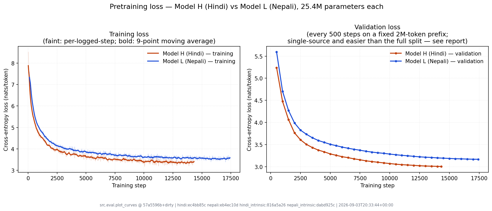

# Devanagari Tiny LMs: Hindi & Nepali Transformers from Scratch

Two identical 25.4M-parameter GPT-style language models, one trained on Hindi
and one on Nepali, with every stage built from scratch: corpus collection and
cleaning, BPE tokenizers, a Transformer written from primitive PyTorch layers
(no `nn.Transformer`, no HuggingFace, no pretrained weights), pretraining,
synthetic reasoning finetuning, and attention analysis. Because the two models
share an architecture and nothing else, the differences between them can be
traced back to the data and the tokenizer.

**Highlights**

- **1.15B tokens collected and cleaned** (520M Hindi, 633M Nepali) from
  Wikimedia dumps, news, government and literary sites, and AI4Bharat Sangraha.
  Content-hash deduplication caught 1,718 identical articles that shared no URLs.
- **Transformer from first principles**: multi-head causal attention, pre-norm
  blocks, weight tying, a closed-form parameter-count assertion, and tests that
  prove the causal mask hides the future and that checkpoint resume is bit-exact.
- **A metric that disagrees with itself**: Hindi wins perplexity (26.80 vs 30.65),
  Nepali wins bits per character (1.196 vs 1.364). The tokenizer explains the gap.
- **Synthetic reasoning benchmark**: a reproducible generator of 55,000
  comparison and transitive-ordering puzzles per language, with held-out names
  and phrasings. Finetuned models learned the answer format (96–100%) but
  memorised entity names: the Hindi model scored 0.62 on names seen in training and 0.30 on new ones.
- **Catastrophic forgetting, measured and fixed**: an aggressive finetune raised
  perplexity 55× (Hindi) and 118× (Nepali). A gentler recipe kept about 96% of
  language-modelling ability and scored higher on reasoning.

<p align="center"></p>

**Read more**: [final report (PDF)](report/final_report.pdf) ·
[Phase 1 report](report/phase1_report.md) ·
[Phase 2 report](report/phase2_report.md) ·
[data and checkpoints on Google Drive](https://drive.google.com/drive/folders/19EANSjwyIp-z36jwCvKhwlWdcwA1Ohhq)

**Quick check** (CPU is enough):

```bash
pip install -r requirements.txt torch numpy pyyaml matplotlib pytest
python -m pytest -q tests
```

*Built as the individual project for Language Models and Agents (CL3-410),
Monsoon 2026. The rest of this README is the full project write-up, phase by phase.*

---

## Phase 1 at a Glance

> **Report** → [`report/phase1_report.md`](report/phase1_report.md) ·
> **Collection ledger** → [`report/collection_ledger.md`](report/collection_ledger.md) ·
> **All data** → [**Google Drive**](https://drive.google.com/drive/folders/19EANSjwyIp-z36jwCvKhwlWdcwA1Ohhq)
> (Anyone with the link → Viewer)

| | Hindi (Model H) | Nepali (Model L) | Requirement |
| :--- | ---: | ---: | :--- |
| Active corpus | **520,409,408 tokens** | **632,711,308 tokens** | ~500M OK  |
| Manual share | **26.87%** | **21.20%** | ≥20% OK  |
| Documents | 848,815 | 1,367,965 | — |
| Tokenizer | `hindi_bpe_8k` | `nepali_bpe_8k` | from scratch, not shared OK  |
| Fertility (tok/word) | 1.4938 | 1.5566 | >1 (sub-word) OK  |
| Unknown-token rate | 0.00% | 0.00% | — |
| Shared documents between corpora | 0 | 0 | none allowed OK  |

**Tokenizer files are committed**, not Drive-only:
[`tokenizers/hindi/`](tokenizers/hindi) · [`tokenizers/nepali/`](tokenizers/nepali)

**Every measured claim in the report is reproducible** — report §7.6 maps each
figure to the command that regenerates it, e.g.:

```bash
python scripts/verify_corpus_claims.py cross-corpus     # corpora share no documents
python scripts/verify_corpus_claims.py uniqueness --language nepali
python scripts/benchmark_tokenizer.py --language hindi --model tokenizers/hindi/hindi_bpe_8k.model ...
```

---

## Phase 2 at a Glance

> **Report** → [`report/phase2_report.md`](report/phase2_report.md) ·
> **Model H** → [`hindi/`](hindi) · **Model L** → [`nepali/`](nepali) ·
> **Checkpoints** → [**Google Drive**](https://drive.google.com/drive/folders/19EANSjwyIp-z36jwCvKhwlWdcwA1Ohhq)
> (Anyone with the link → Viewer)

Phase 2 builds a decoder-only Transformer from primitive PyTorch layers — no
`nn.Transformer`, no HuggingFace, no pretrained weights — and trains two
instances of it from scratch on the Phase 1 corpora: **Model H** on Hindi and
**Model L** on Nepali. The two share no data, tokenizer, vocabulary, or weights.
Only the implementation is common.

### How they were trained

| | Model H (Hindi) | Model L (Nepali) |
| :--- | ---: | ---: |
| Trainable parameters | **25,379,840** | **25,379,840** |
| Training tokens (1 epoch) | 468,638,315 | 571,113,472 |
| Steps × tokens/step | 14,329 × 32,768 | 17,429 × 32,768 |
| Wall-clock (T4, fp16) | 3.69 h | 4.87 h |
| Throughput | 36,898 tok/s | 36,457 tok/s |
| Final train loss | 3.4603 | 3.5265 |

### How well they model unseen text

Measured after training, over the **complete** validation and test splits — 58M
tokens, every one predicted exactly once ([`src/eval/intrinsic.py`](src/eval/intrinsic.py)).

| | Model H (Hindi) | Model L (Nepali) |
| :--- | ---: | ---: |
| Test cross-entropy | 3.2885 | 3.4228 |
| **Test perplexity** | **26.80** | 30.65 |
| **Test bits-per-byte** | 0.5371 | **0.4495** |
| Test bits-per-character | 1.3636 | **1.1964** |
| Validation perplexity | 26.77 | 30.64 |
| Bytes / token | 8.833 | 10.985 |
| Characters / token | 3.479 | 4.127 |

Three metrics, because one is not enough to compare two models that use
different tokenizers:

* **Perplexity** = `exp(cross-entropy)`. Roughly, how many equally-likely tokens
  the model is choosing between at each step. A perplexity of 26.8 out of a
  vocabulary of 8,000 means the model has narrowed the field by ~300×. But it is
  measured *per token*, and a token means something different in each model.
* **Bits-per-byte** re-expresses the same loss per byte of the underlying UTF-8
  text, which cancels the tokenizer out.
* **Bits-per-character** does the same per character. Since both languages use
  Devanagari but have different tokenizers, this is the fairest of the three
  here.

**The three metrics disagree, and that disagreement is the main result.** Hindi
wins on perplexity by 14.4%; Nepali wins on bits-per-byte by 19.5% and on
bits-per-character by 14.0%.

The cause is **tokenizer fertility**. Nepali's 8k BPE packs **4.127 characters
per token against Hindi's 3.479** — 18.6% more text behind every token. So each
Nepali prediction commits to more of the underlying string and is a genuinely
harder problem. Per-token perplexity charges Nepali for that; per-character and
per-byte normalisation credit it. This is exactly why the brief requires BPB
*"to make the two languages more comparable when tokenizers differ"*, and why the
obvious reading — *"Hindi is the better model, its perplexity is lower"* — is
wrong.

BPB is not perfectly neutral either: Nepali averages **10.985 bytes/token**
against Hindi's **8.833**, so some of its BPB advantage is UTF-8 encoding
density rather than model quality. Bits-per-character still favours Nepali, by
the smaller 14.0% margin. [Report §4.2](report/phase2_report.md) works through
all three, including what the comparison does *not* control for.

**Neither model overfitted.** Validation loss decreased at every one of the 29
and 35 evaluations, so the best checkpoint is the final one in both runs. The
full-split measurements confirm it independently: validation and test agree to
three significant figures for both models (H: 26.77 / 26.80; L: 30.64 / 30.65),
which is what a model that has not memorised its validation set looks like. Both
runs are **data-limited rather than converged** — they were still improving when
the one-epoch token budget ran out.

> [!IMPORTANT]
> **The training curves show different numbers, and the gap is deliberate, not
> an error.** During training the loop scored a fixed 2M-token *prefix* of the
> validation split for speed. The Phase 1 splits are written grouped by source,
> so that prefix covers Wikibooks, Wikiquote, the news crawl and part of the
> manual web crawl — and never reaches `sangraha`, which is **71.6%** of Hindi
> validation documents and **77.5%** of Nepali's. That prefix is both
> unrepresentative and easier, and it reported perplexity ~30% below the truth
> (H: 20.19 against a real 26.77; L: 23.77 against 30.64).
>
> Checkpoint selection was unaffected — validation loss was strictly monotonic,
> so the last checkpoint is the best one under any consistent measure. But the
> curve must be read as *a consistent progress signal on one slice*, not as *the
> model's perplexity*. [`report/figures/val_perplexity.png`](report/figures/val_perplexity.png)
> plots both, with the gap annotated, rather than quietly substituting one for
> the other. **Every number quoted in this README and the report is the
> full-split one.** Lesson 20 below has the post-mortem.

**Corpus sizes are measured, not estimated.** Every byte of all six split files
was tokenized with the committed Phase 1 models on 2026-09-02: Hindi
**520,392,597** tokens and Nepali **632,746,902**. These confirm the Phase 1
estimates above to within **0.006%** — Phase 1 derived its counts as
characters ÷ measured chars-per-token, and that approximation holds.

> [!NOTE]
> **Model H and Model L have identical parameter counts** because both Phase 1
> vocabularies came out at exactly 8,000. That makes the H-vs-L comparison a
> controlled test of the *data* rather than of capacity, and it is why the
> Transformer implementation lives once in `src/` instead of being duplicated
> per language.

---

## Phase 3 at a Glance

> **Report** → [`report/phase3_report.md`](report/phase3_report.md) ·
> **Generator** → [`src/reasoning/`](src/reasoning) ·
> **Sample data** → [`data/hindi/reasoning/sample.md`](data/hindi/reasoning/sample.md) ·
> [`data/nepali/reasoning/sample.md`](data/nepali/reasoning/sample.md) ·
> **Corpora + finetuned checkpoints** → [**Google Drive**](https://drive.google.com/drive/folders/19EANSjwyIp-z36jwCvKhwlWdcwA1Ohhq)

Phase 3 finetunes each pretrained model on a **synthetic comparative-reasoning
corpus in its own language**, scores it against the pretrained model, and
compares attention before and after. The two corpora are generated by the same
code from entirely separate Hindi and Nepali inventories — the models share the
generator and nothing else.

**The corpus.** 50,000 examples per language (40k / 5k / 5k), ten template
families, six attributes over two entity domains, spanning direct comparison
through two-hop transitive chains:

| Premises | Question | Hops | Example family |
| :--- | :--- | ---: | :--- |
| `राम की ऊँचाई श्याम से अधिक है।` | which one | 0 | `rel2_which` |
| three quantities stated | k-th in descending order | 0 | `val4_rank` |
| `A > B`, `B > C` | largest / smallest | 1 | `rel3_extreme` |
| `A > B`, `B > C`, `C > D` | relation between **A and D** | 2 | `rel4_pairwise` |

In the chain families the two entities the question asks about are *never
compared to each other* in the premises, so the answer exists only as a
consequence of chaining. Accuracy is reported against hop count, which
separates "learned to match a stated comparison" from "learned to chain".

**Three enforced leakage controls**, all measured rather than asserted — the
generator exits non-zero if any fails:

| Check | Hindi | Nepali |
| :--- | ---: | ---: |
| Entities shared between train and test | **0** | **0** |
| Prompts shared between train and test | **0** | **0** |
| Prompts shared between val and test | **0** | **0** |
| Test examples using held-out phrasing | 1,214 / 5,000 | 1,214 / 5,000 |

`tests/test_reasoning_data.py` goes further: it re-parses the rendered
Devanagari back into an ordering and checks **every** answer against it. Reading
the generator's own metadata would only prove it agrees with itself; a premise
renderer that stated an inequality backwards would pass that and silently
invert part of the corpus.

**Three test sets, not one.** A pooled accuracy makes three different failures
look identical, so all three cells of the grid are generated and reported
separately:

| Split | Entities | Wording | A low score means |
| :--- | :--- | :--- | :--- |
| `test_seen` | seen | seen | training did not fit the distribution at all |
| `test`, seen phrasing | unseen | seen | it memorised entity names |
| `test`, held-out phrasing | unseen | unseen | it memorised the template |

`test_seen` is the control — distributionally identical to training, and unlike
`val` it never selected a checkpoint, so its accuracy carries no selection
optimism. The comparison table derives a **memorisation gap** (seen minus unseen
entities, same wording) and a **template gap** (seen minus held-out wording,
same entities), each attributing the drop to the one thing that changed.

**Finetuning is also checked for damage.** Supervised finetuning on a narrow
task can destroy general next-token prediction, so `src/eval/intrinsic.py` —
the Phase 2 evaluator, unchanged apart from a new `--max-tokens` budget — scores
each model's *pretraining* validation split before and after. A reasoning gain
reported without that number is an incomplete result.

### What we found, in plain terms

Full detail in [report §1.1](report/phase3_report.md) and §5. In short:

**The models learned the shape of an answer, not the answer.** Asked a
comparison question, they reply `उत्तर:` followed by a name, correctly
formatted, 96–100% of the time. They just pick the wrong name.

**They memorised names.** They only ever answer with names from the training
set. Ask about भरत — a name held back for testing — and Model H answers सीता,
a name it trained on. Sometimes it answers a question about a person with the
name of an object. Since the test set uses only unseen names, questions whose
answer *is* a name score **0%**.

**Where the answer is one of three words** — "more", "less", "equal" — they
score **45–67%**, against 33% for guessing. So they did learn something real
about comparison. It only shows where naming isn't required.

| | Model H (Hindi) | Model L (Nepali) |
| :--- | ---: | ---: |
| Exact match, unseen names | 0.2458 | 0.2144 |
| Exact match, familiar names | 0.6226 | 0.4542 |
| **Memorisation gap** \* | **0.3770** | **0.2426** |
| Unseen *wording* costs | ~0 | ~0 |

\* measured between splits that match on wording, so only the name pool differs.

**It cost them their language ability.** Before finetuning, Model H predicted
ordinary Hindi with a perplexity of 20; afterwards, 1,115 — **55× worse**. Model
L went 24 → 2,802, **118× worse**. Both keep only 33% and 18% of what
pretraining taught them. This effect has a name — *catastrophic forgetting* —
and the course material warns about it explicitly.

**The clearest single number:** the *pretrained* Model H, shown four worked
examples, produced a correctly formatted answer **99.98%** of the time and got
**0.00%** right. Format and reasoning are separate things, and that number
separates them.

**Our first training settings were too aggressive — and the gentler ones were
better at everything.** Repeating the finetune at 1 epoch and a third the
learning rate:

| Model | Recipe | Questions right | Language ability kept | Train time |
| :--- | :--- | ---: | ---: | ---: |
| H | 3 epochs @ 1e-4 | 0.2458 | 33% | 4.8 min |
| H | **1 epoch @ 3e-5** | **0.2992** | **96%** | **1.5 min** |
| L | 3 epochs @ 1e-4 | 0.2144 | 18% | 4.9 min |
| L | **1 epoch @ 3e-5** | **0.2320** | **96%** | **1.7 min** |

There was no trade-off to find — only a wasteful recipe. Both are reported
(§5.6), because the comparison is the finding and because the reasoning for the
aggressive settings was written down in advance and turned out to be wrong.

**The two problems are one problem.** The aggressively trained models could
never name a person they hadn't seen before. Naming someone mentioned in the
question means copying a word out of the text you were given — a language
ability, and exactly what the aggressive training destroyed. The gentle models
keep theirs, and every bit of their extra accuracy comes from those questions.

**A tokenizer finding that Phase 2 could not see.** Measured by encoding the
Phase 3 corpus with each language's own Phase 1 tokenizer:

| | Model H (Hindi) | Model L (Nepali) |
| :--- | ---: | ---: |
| Devanagari-numeral pieces in the 8k vocabulary | 42 | **158** |
| Tokens per stated quantity | 2.044 | **1.458** |
| Corpus fertility (chars/token) | 3.481 | **4.126** |
| Fertility retained on this synthetic text | **89.4%** | 78.8% |

The lower-resource tokenizer is simultaneously **better at numerals** — Nepali
web text is dense with Bikram Sambat dates, so BPE learned nearly four times as
many multi-digit merges — and **less robust off its own corpus**, losing twice
as much fertility out of domain. Two consequences of the same corpus
homogeneity, pulling in opposite directions.

> [!NOTE]
> Exact match on this task is the first **tokenizer-independent** metric in the
> project. Phase 2's H-vs-L comparison was genuinely ambiguous — Hindi wins
> perplexity by 14.4%, Nepali wins bits-per-character by 14.0%, and the
> difference is fertility rather than model quality. A correct answer is a
> correct answer regardless of how many tokens it cost to encode.

---

## Project Overview

This project builds two completely independent, from-scratch decoder-only Transformer language models (~25M parameters each) for two Indian languages sharing the Devanagari script:
* **Model H (Higher-Resource)**: **Hindi** (`hi`)
* **Model L (Lower-Resource)**: **Nepali** (`ne`)

### Strict Monolingual Constraints
* **Zero Shared Artifacts**: Each model has its own distinct corpus, tokenizer vocabulary, embedding matrix, and model weights.
* **No Pretrained Models or Tokenizers**: Built strictly from scratch using primitive PyTorch layers (custom Multi-Head Attention, Positional Encodings, and Causal Masking). No Hugging Face `Transformer` model classes.
* **Token Targets**: ~500M tokens per language monolingual corpus, adhering to the at least 20% manual collection and at most 80% automated collection requirement.

---

## Repository Structure

> [!NOTE]
> **Phase 2 layout: shared implementation, per-language artifacts.**
> Guideline 7 of the brief asks for the repository organized by language; guideline 1
> asks for modular, non-duplicated code. Both Phase 1 vocabularies came out at exactly
> **8,000**, so Model H and Model L are *architecturally identical* — same 25,379,840
> parameters, same tensor shapes. Duplicating `model/`, `train/`, and `eval/` into two
> trees would mean maintaining two copies of the same network, where a fix applied to
> one and missed in the other silently breaks the very H-vs-L comparison the project
> is built on.
>
> So the Transformer implementation lives once under `src/`, while **`hindi/` and
> `nepali/` are self-contained for everything that actually differs**: configs, training
> logs, loss curves, evaluation outputs, generated samples, attention figures, and
> checkpoint links. The constraint guideline 7 protects is fully met — **the two models
> share no data, tokenizer, vocabulary, or weights.** Phase 1 already set this precedent
> with a shared `src/data/` alongside `data/{lang}` and `tokenizers/{lang}`.

```text
hindi/                               # Model H — self-contained artifacts
├── README.md                        #   corpus counts, run command, Drive links
├── configs/model.yaml               #   architecture (25,379,840 params)
├── configs/train.yaml               #   optimizer, schedule, paths
├── logs/train.jsonl                 #   per-step log -> loss curve
├── figures/ eval/ samples/          #   plots, metrics, generations
nepali/                              # Model L — same structure
src/
├── data/pack_tokens.py              # JSONL -> uint16 token stream
├── model/                           # embeddings, attention, block, TransformerLM
├── train/                           # dataset, trainer, checkpointing
│   ├── reasoning_dataset.py         #   Phase 3: answer-span loss masking
│   └── finetune.py                  #   Phase 3: finetune from a pretrained ckpt
├── reasoning/                       # Phase 3 synthetic corpus generator
│   ├── entities.py                  #   per-language names, attributes, agreement
│   ├── templates.py                 #   10 families, surface realisations, renderer
│   ├── answers.py                   #   answer extraction (the parser side of the format)
│   └── generate.py                  #   sampling, dedup, splits, leakage checks
└── eval/                            # PPL/BPB, generation, metrics, attention
    ├── reasoning_eval.py            #   Phase 3: exact match, 3 setups
    ├── attention_reasoning.py       #   Phase 3: pretrained vs finetuned attention
    └── compare_reasoning.py         #   Phase 3: comparison tables, error analysis
tests/                               # causal mask, param count, checkpoint resume,
                                     # reasoning labels + leakage (torch-free)
```

```text
.
├── configs/                         # Model & training configurations
├── data/                            # Local corpus staging & manifests
│   ├── hindi/
│   │   ├── manifests/               # Collection & split manifests
│   │   ├── processed/               # Cleaned JSONL shards
│   │   └── splits/                  # train / val / test splits & tokenized data
│   └── nepali/
│       ├── manifests/               # Process-safe collector lock & manifests
│       ├── processed/               # Cleaned web & wiki shards
│       ├── sources/                 # Seed URLs by category (Gov, News, Lit, Wiki)
│       └── splits/                  # train / val / test splits
├── notebooks/                       # End-to-end Colab execution pipelines
│   ├── collect_hindi_colab.ipynb    # Hindi automated + manual collection & tokenizer training
│   ├── collect_nepali_colab.ipynb   # Nepali automated + manual collection & tokenizer training
│   ├── finalize_hindi_corpus.ipynb  # Budget-aware Hindi split + tokenizer retrain
│   ├── finalize_nepali_corpus.ipynb # Budget-aware Nepali split + tokenizer retrain
│   ├── remaining_hindi_manual_collection.ipynb  # Hindi news crawl -> manual_news_shard_0033-0038
│   ├── ocr_nepali_books_colab.ipynb # OCR route for Nepali print sources
│   └── phase1_pipeline.py           # Standalone modular pipeline runner
├── tokenizers/                      # Deliverables 6 & 7 — committed, not Drive-only
│   ├── hindi/hindi_bpe_8k.{model,vocab}
│   └── nepali/nepali_bpe_8k.{model,vocab}
├── report/                          # Phase reports, metrics, plots, and analysis
│   ├── phase1_report.md             # Phase 1 report
│   ├── collection_ledger.md         # Every collection stage: commit, script, shards, counts
│   ├── collection_ledger.json       # Machine-readable source for the above
│   └── {hindi,nepali}_tokenizer_benchmark.json
├── scripts/                         # Collection, audit, and validation suites
│   ├── discover_sitemap_urls.py     # robots.txt -> sitemap article-URL discovery
│   ├── collect_manual_web_sitemap.py    # Resumable crawler (--language hindi|nepali)
│   ├── process_hindi_wikimedia_dump.py  # Wikimedia XML dump -> manual shards
│   ├── export_manual_hashes.py      # Dedup registry, streamed from Drive
│   ├── benchmark_tokenizer.py       # Fertility / coverage / vocab sweep on held-out text
│   ├── render_collection_ledger.py  # collection_ledger.json -> collection_ledger.md
│   ├── verify_corpus_claims.py      # Reproduces every measured claim in the report
│   ├── probe_sitemap_availability.py # Which outlets publish crawlable sitemaps
│   ├── audit_hindi_corpus.py        # Exact per-source token accounting from Drive
│   ├── audit_batch1_checkpoint.py   # 1,000-doc verification & Drive sharding audit
│   ├── audit_existing_corpus_language.py
│   ├── expand_source_urls.py        # Recursive category crawler
│   └── test_collector_concurrency.py
├── src/                             # Core modular package
│   ├── data/
│   │   ├── clean/                   # Devanagari cleaning & language ID
│   │   │   ├── clean_hindi_web.py   # Line-level web cleaner & teaser stripper
│   │   │   ├── clean_nepali_web.py  # Nepali marker vocabulary over the same cleaner
│   │   │   ├── clean_nepali.py      # Table stripping & citation cleaner
│   │   │   ├── nepali_lang_id.py    # Composite lexical/script language detector
│   │   │   └── migrate_manifest_schema.py
│   │   ├── collect/                 # Collection engines
│   │   │   ├── collect_manual_web.py    # Process-safe Trafilatura crawler
│   │   │   ├── collect_wikimedia_api.py # Wikimedia REST/Action API collector
│   │   │   ├── process_hf_corpus.py     # Automated Hugging Face extractor
│   │   │   └── process_wiki_dump.py     # Fast Wikipedia XML bz2 parser
│   │   ├── deduplicate/             # Content & URL deduplication
│   │   │   └── dedup.py             # SHA-256 exact dedup & merger
│   │   ├── shard_manager.py         # Google Drive rclone packaging & verification
│   │   ├── storage_guard.py         # Disk quota safety monitoring
│   │   └── split/                   # Stratified train/val/test split generator
│   │       └── create_splits.py
│   └── tokenizer/                   # Custom tokenizer training
│       └── train_bpe.py             # SentencePiece BPE trainer (configurable vocab)
├── requirements.txt                 # Pinned collection / tokenizer dependencies
└── README.md
```

---

## The Engineering Journey

*Lessons 1–14 are Phase 1 (collection, cleaning, tokenizer); 15–19 are Phase 2
(packing, training, checkpointing). Each records a decision that cost something
to learn.*

Building a ~500M token corpus per language on student-tier compute (free Google Colab GPUs/CPUs) required significant architectural iteration. Below is the technical log of the engineering challenges encountered and how our pipeline evolved into a zero-RAM, crash-resilient streaming system.

### 1. The Naive Multi-Source Pipeline and Its Bottlenecks
* **Initial Plan**: Ingest web data from multiple Hugging Face datasets (`ai4bharat/sangraha`, `uonlp/CulturaX`, `cc100`, `oscar`) using `datasets.load_dataset(..., streaming=True)` alongside local web scraping.
* **The Reality**: 
  1. Multilingual web corpora contained significant English boilerplate, navigation junk, and uncurated machine translation.
  2. The `datasets` library streaming engine suffered from erratic socket timeouts, authentication friction on Colab, and internal Arrow buffer caching that caused memory usage to creep upward indefinitely.

### 2. Preserving the 20% Manual Requirement (Avoiding Wikipedia Overlap)
* **The Conflict**: Per course rules, Wikipedia XML dumps processed and cleaned in-house count as manual collection (at least 20%). However, generic web crawls from automated datasets often scrape Wikipedia pages. If automated web scraping ran first, exact hash-deduplication would discard our manual Wikipedia dump articles.
* **The Solution**: Re-ordered collection priorities to ingest non-web automated data (PDF/ASR transcripts from Sangraha) first, followed by the complete manual Wikipedia dump, ensuring 100% of our manual articles were preserved without cross-source collision.

### 3. Google Colab Disconnections and Stateful Drive Checkpointing
* **The Challenge**: Standard Colab sessions disconnect or reset after idle periods, instantly wiping local disk storage (`/content/`). A single 3-hour interrupted run meant starting from scratch.
* **The Solution**: Transformed the pipeline into a fully stateful, crash-safe architecture:
  * JSONL shards flush directly into Google Drive (`DRIVE_BASE/cleaned/...`).
  * On reconnect/restart, the notebook stream-reads existing shards, reconstitutes the deduplication hash set, tallies current token progress, and resumes execution without re-downloading or duplicating records.

### 4. Memory Triage: 64-bit Integer Hashing and Zero-RAM Splitting
* **The Challenge**: Tracking millions of unique 64-character SHA-256 strings in a Python `set` consumed several gigabytes of RAM, triggering Colab Out-Of-Memory (OOM) process termination. Similarly, loading the entire merged corpus into memory to split `train/val/test` caused immediate crashes.
* **The Solution**:
  * **64-bit Integer Hashing**: Stored only the first 16 hex characters as 64-bit integers (`int(sha256[:16], 16)`), reducing dedup memory consumption by **~75%**.
  * **Zero-RAM Streaming Splitting**: Replaced in-memory split logic with a streaming file router: each incoming document is assigned via a pseudo-random seed directly to `train.txt`, `val.txt`, or `test.txt` disk handles.
  * **SentencePiece Capping**: Configured `input_sentence_size=500_000` to train high-fertility BPE models without loading multi-gigabyte text files into SentencePiece memory.

### 5. Ditching the `datasets` Library for Pure PyArrow Streaming
* **The Challenge**: Even with streaming enabled, `load_dataset('ai4bharat/sangraha', ...)` periodically hung when establishing HTTP stream connections to Hugging Face parquet shards.
* **The Solution**: Replaced Hugging Face's wrapper with direct Python `urllib.request` + `pyarrow`. The notebook queries the Hugging Face API for the parquet file listing, downloads one ~340MB file at a time to local disk, processes it, flushes shards to Drive, deletes the temporary file, and triggers `gc.collect()`.

### 6. The Wikipedia XML Memory Leak (`root.clear()`)
* **The Challenge**: During streaming parse of Wikipedia dumps (`newiki-latest-pages-articles.xml.bz2`), Python's `xml.etree.ElementTree.iterparse` accumulated parent DOM references, leaking memory from ~200MB up to 10GB+ before crashing.
* **The Solution**: Added `root.clear()` alongside `elem.clear()` on every processed `<page>` element, keeping XML parsing memory strictly flat under **300MB RAM** across all 50,000+ Wikipedia articles.

### 7. The `data-0.parquet` Trap and Micro-Batching
* **The Challenge**: In the Sangraha repository, `data-0.parquet` is an uncompressed ~8.6GB behemoth that instantly exhausts local Colab disk space, whereas subsequent shards (`data-1.parquet`, `data-2.parquet`, etc.) are neat ~340MB files.
* **The Solution**: Explicitly filtered out `data-0.parquet` and processed the ~340MB files using `pyarrow.parquet.ParquetFile.iter_batches(batch_size=5000)`. Only ~20MB of records are ever held in memory at any millisecond.

### 8. The 20% Floor Is a Multiplier, Not an Independent Check
* **The Challenge**: The Hindi corpus stalled below target and the reason was
  structural. A manual share of at least 20% means automated data may be at most
  $4\times$ the manual total, so the **reachable corpus is capped at $5\times$
  the manual token count**. With 88.8M Hindi manual tokens the whole corpus was
  capped at 444M — under the 500M target — while 683M automated tokens sat
  unusable in reserve. No amount of extra automated data could have helped.
  Collecting 161M further manual characters lifted the ceiling to ~699M and the
  delivered corpus to 520.4M tokens at a 26.87% manual share.
* **The Solution**: Size manual collection from the target first
  ($\text{target} / 5$ = minimum manual), and derive the automated budget from
  the manual total at split time as $A = \min(4M,\ T - M)$, so both constraints
  are enforced together rather than one being applied and the other hoped for.

### 9. Guessed URLs vs. Published Sitemaps
* **The Challenge**: The first Hindi news crawler enumerated articles by guessing
  sequential ids (`amarujala.com/india-news/news-id-849999`). Publishers do not
  expose contiguous id spaces; almost every request 404'd and the crawl produced
  13 MB of text.
* **The Solution**: `scripts/discover_sitemap_urls.py` reads each publisher's
  `robots.txt`, follows every `Sitemap:` directive and descends the sitemap index.
  The naive guess of `/sitemap.xml` is itself wrong nearly everywhere — `ndtv.in`
  and `zeenews` return 403, `bhaskar`, `aajtak`, `abplive`, `livehindustan`,
  `news18` and `naidunia` return 404 — yet all of them publish working sitemaps via
  `robots.txt`. Result: **11,112,623 live article URLs across 18 domains in 7.6
  minutes**, reservoir-sampled to a domain-balanced 375,539-URL frontier.

### 10. Devanagari Is Not a Language Filter
* **The Challenge**: Script-ratio filtering cannot separate Hindi from other
  Devanagari languages. `vikaspedia.in` serves ~15 languages from sibling
  subdomains including Nepali (`ne.`), Sanskrit (`sa.`), Maithili and Konkani —
  Nepali being exactly the language of Model L, whose corpus must stay disjoint.
* **The Solution**: Exclude non-Hindi hosts at the frontier, and score every
  crawled document with `hindi_lang_id.py`, which rejects text whose
  Nepali/Sanskrit lexical density exceeds its Hindi density. Auditing the
  pre-existing manual shards the same way returned 97.9–100% Hindi, with a single
  Sanskrit page in the Wikibooks shard.

### 11. Two Transport Traps on the Way to Drive
* **`--bind 0.0.0.0`**: added to work around an intermittent IPv6 route failure
  that aborts rclone during *filesystem construction*, before `--retries` applies.
  Measured effect on this link: throughput collapsed from **1.2 MB/s to 21 KB/s**.
  The fix is an application-level retry loop, not a source-address bind.
* **`RobotFileParser.read()`**: fetches `robots.txt` with urllib's User-Agent,
  which several Hindi portals answer with 403 — and on 403 the parser silently
  switches to *disallow-all*. Left unfixed, this rejected 100% of the frontier
  while reporting a clean run. Fetch `robots.txt` with the crawler's own
  User-Agent and hand the text to `rp.parse()`.

### 12. Asserting on the Plan Instead of the Result
* **The Challenge**: The split notebook staged shards from Drive to local disk with
  a single bulk `cp ... 2>/dev/null`. The FUSE transport dropped partway, the error
  went to the null device, and **2 of 220 automated shards** reached the machine.
  Every downstream check still passed — the budget assert only verified the target
  was *reachable* — so a corpus that was 95.7% manual was written to Drive with no
  warning anywhere. The same silent-truncation bug appeared in the audit and
  dedup-registry scripts, where a short `rclone cat` through a pipe is
  indistinguishable from a short file; it under-reported the corpus by 10,000
  documents.
* **The Solution**: Never move or read a remote shard without verifying the byte
  count against the source, and assert on the *ingested result*, not the plan.
  Staging now copies per file, compares sizes, remounts on `Errno 107` and retries;
  the split refuses to sync unless the automated ingest reached 98% of its budget,
  the total clears 500M, and the manual floor holds.

### 13. Deduplicate the Manual Partition Against Itself
* **The Challenge**: The pipeline deduplicated manual→automated but never
  manual→manual, on the assumption that each collection run had already deduplicated
  itself. It had — but against a registry snapshotted before later shards existed, so
  every run was blind to the ones that followed. Auditing found **2,523 exact
  duplicates / 18.6M characters**, 94% of them because `manual_lit_shard_0030` is a
  re-parse of the same Wikimedia dumps behind `manual_aux_shard_0032`: 2,365 of its
  2,366 documents were already present.
* **The Solution**: Deduplicate the manual partition against itself *before* deriving
  the automated budget from it — otherwise duplicate characters inflate the budget as
  well as the corpus. The freshly written sitemap crawler accounted for 9 of the
  2,523, so the cost of a stale registry falls on whichever run collects last.

### 14. Final High-Yield Convergence (~400M Tokens in ~25 Minutes)
* **The Breakthrough**: Originally, we filtered Sangraha strictly for PDF and ASR transcripts. However, because each 340MB parquet chunk contained mixed document types, discarding web text meant each file yielded only 2–3M tokens, requiring over 50 files to hit our target.
* **The Final Architecture**: Sangraha Verified documents are human-curated and clean. By accepting all verified documents (PDF, ASR, and Web), each 340MB file yielded **35M+ clean tokens**. The entire 400M automated token target is now reached in just **11–12 parquet files (~25 minutes total runtime)**.

---

### Phase 2 — Packing, Training, and Checkpointing

### 15. Pack the Corpus Once, Not Once Per Step

* **The Challenge**: Tokenizing on the fly inside the training loop would have put
  SentencePiece encoding and Drive I/O on the critical path of all 31,758 steps.
* **The Solution**: `src/data/pack_tokens.py` encodes each split once into a flat
  `uint16` array. The vocabulary is 8,000, so a token id fits in two bytes:
  Hindi's training text drops **3.86 GiB → 0.87 GiB** and Nepali's
  **5.83 GiB → 1.06 GiB**. The trainer memory-maps the result, so a batch is a
  slice rather than a parse. This is a lossless change of representation — the
  packed output was verified byte-identical to a sequential single-process
  encode — not a subsample.

### 16. `\n\n` Is Not a Document Boundary

* **The Challenge**: `create_splits.py` writes the plain-text splits as
  `text.strip() + "\n\n"`, so the obvious way to place `<eos>` is to split on a
  blank line. But **81.9% of documents contain internal blank lines**. Splitting
  Hindi's `train.txt` that way yields **1,859,604 blocks against 848,815 real
  documents — 2.19×**.
* **Why it matters**: `<eos>` at 2.2× too many positions teaches the model that
  documents end mid-article, which is exactly what makes generation terminate
  early.
* **The Solution**: Pack from the `.jsonl`, one JSON object per line. The
  resulting `<eos>` counts came to **848,815** and **1,367,965** — matching the
  Phase 1 document counts exactly, to the document.

### 17. Bits-Per-Byte Must Count Text Bytes, Not File Bytes

* **The Challenge**: The packer's first version counted `len(raw)` per JSONL line
  for its `n_bytes_utf8` statistic. That line also carries `doc_id`, `source`,
  `collection_type`, `language`, and `text_sha256` — **45% envelope on a typical
  record**.
* **Why it matters**: `BPB = CE / (ln2 × bytes_per_token)`. Inflating
  bytes/token by 6% **understates BPB by 5.7%**, flattering both models, and the
  envelope ratio differs between the two languages — so it would have skewed the
  H-vs-L comparison in an unpredictable direction.
* **How it surfaced**: the packer reported 9.38 bytes/token for Hindi where an
  earlier independent pass over the `.txt` files had measured **8.85**. One
  number disagreeing with another is the only reason it was caught.
* **The Solution**: count `len(text.encode("utf-8"))`, and a `--repair-bytes`
  mode that corrects existing sidecars without re-tokenizing.

### 18. A Resume Test That Passes on CPU Proves Nothing About the GPU

* **The Challenge**: `test_checkpoint_resume.py` asserted that training after a
  save/load cycle reproduces uninterrupted training *exactly* — and it passed.
  The first real GPU resume then died with
  `TypeError: RNG state must be a torch.ByteTensor`.
* **The Cause**: the trainer loaded with `map_location="cuda"`, which moves
  **every** tensor in the payload to the GPU, RNG states included.
  `set_rng_state_all()` requires CPU byte tensors. The tests saved and loaded on
  CPU, so the only code path that ever runs in production was never exercised.
* **The Solution**: load with `map_location="cpu"` (`load_state_dict` copies into
  an already-on-GPU model regardless), coerce RNG states back to CPU `uint8`
  anyway, and make restoration **best-effort** — correct weights matter, an
  exactly replayed dropout stream does not. Plus two regression tests that
  simulate a GPU-shaped payload.

### 19. A Smoke Run Must Not Be Able to Touch Real Checkpoints

* **The Challenge**: the 100-step smoke run wrote to a throwaway `--ckpt-dir`,
  but `mirror_to` was still active in the config, so its toy checkpoints were
  pushed to the real Drive folder. The subsequent full run found them and
  resumed a 4-hour job from a 100-step model.
* **The Solution**: a `--no-mirror` flag, used by both notebooks' smoke cells, and
  the contaminated remote purged before relaunching.

### Phase 2 — Evaluation

### 20. A Validation Prefix Is Not a Validation Set

* **The Challenge**: training validated on `val_tokens: 2000000` — the *first*
  2M tokens of the split. The Phase 1 splits are written grouped by source, so
  that prefix is Wikibooks, Wikiquote, the news crawl and part of the manual web
  crawl, and never reaches `sangraha` — **71.6%** of Hindi validation documents
  and **77.5%** of Nepali's. Both models reported perplexity about **30% below
  the truth** for the entire run (H: 20.19 against a real 26.77).
* **How it surfaced**: only when the post-training full-split pass disagreed with
  the training curve by the same ~30% for *both* models. A consistent gap across
  two independent runs is a systematic error, not noise.
* **Why it was survivable**: validation loss was *strictly* monotonic across all
  29 and 35 evaluations, so the best checkpoint is the last one under any
  consistent measure. Checkpoint selection was unaffected; only the reported
  number was wrong.
* **The Solution**: quote full-split figures everywhere, and plot the curve
  *against* the true value rather than substituting one for the other —
  `report/figures/val_perplexity.png` shows both with the gap annotated. The
  underlying fix for a future run is to sample validation windows at random
  offsets, or to shuffle documents before writing splits.
* **The lesson**: a cheap evaluation slice must be *representative*, not merely
  *consistent*. Taking a prefix of a file that has any ordering to it samples the
  ordering, not the distribution.

### 21. BLEU Ranked the Degenerate Decoder Highest

* **The Challenge**: on open-ended continuation, BLEU-4 peaked at temperature
  0.5 — a setting whose output visibly repeats itself — and scored the coherent
  temperature-1.0 samples *lower*. Hedging towards frequent words raises n-gram
  overlap with any reference, so the metric rewards exactly the failure mode a
  reader would reject.
* **The Solution**: report chrF++ alongside, which ranks the settings the way a
  reader does, and add reference-free metrics with the **held-out human text
  scored as a control row**. "Distinct-2 of 85.6%" means nothing alone; "85.6%
  against the corpus's own 83.5%" is a finding.
* **The lesson**: a metric borrowed from translation does not transfer to free
  generation just because both produce text. Report §5.3 works through which of
  the five is informative here and why.

### 22. Two Silent Failures in the Same Notebook Cell

* **The Challenge**: attention heatmaps rendered with numeric axis labels
  instead of Devanagari. Two independent causes, both silent: `apt-get install
  fonts-noto-devanagari` failed because the package does not exist in Colab's
  index, and its error was hidden by a `> /dev/null 2>&1`; and matplotlib caches
  its font list per process, so even once `fonts-indic` was installed, a freshly
  spawned subprocess loaded the cache written *before* installation and could not
  see it. The in-kernel font check passed while the subprocess doing the work
  failed.
* **The Solution**: install `fonts-indic`, stop suppressing apt's output, and
  have `attention_analysis.py` scan the filesystem and `addfont()` directly
  rather than trusting the cache. The module records the font it resolved in its
  provenance block, so `"devanagari_font": null` is visible in the artefact
  rather than only in the picture.
* **The lesson**: suppressing output on an install step converts a loud failure
  into a silent one that surfaces three cells later as a cosmetic defect. And a
  capability check must run in the process that needs the capability.

---

## Dataset and Cleaning Specifications

### Quality Filters Applied
1. **Devanagari Script Purity**: Every document must meet a minimum Devanagari ratio of at least 0.50 (Devanagari Unicode block `\u0900`–`\u097F`).
2. **Length Threshold**: Minimum clean document length of at least 100 characters.
3. **Markup and Table Removal**: MediaWiki syntax, XML tables, citations (`[1]`), and external navigation links stripped via regex pipelines.
4. **Composite Language Identification**: Heuristic and lexical signature filtering (differentiating Nepali case markers like `लाई`, `मा`, `बाट` from Hindi markers `है`, `में`, `पर`) to reject cross-lingual contamination.
5. **Exact Deduplication**: SHA-256 content hashing across all manual and automated shards.

### Split Stratification & Corpus Accounting
All corpora are partitioned using a reproducible document-level split (Seed `42`):
A document's split is a function of its content hash, so assignment is stable
regardless of shard ingest order and no document can leak across splits.

| Split | Purpose | Hindi tokens | Nepali tokens |
| :--- | :--- | ---: | ---: |
| **Train** (90%) | Pretraining, and tokenizer fitting | 467,905,255 | 569,663,061 |
| **Validation** (5%) | Loss, perplexity (PPL), bits-per-byte (BPB) | 26,069,560 | 31,697,868 |
| **Test** (5%) | Generation quality (BLEU, chrF, ROUGE-L), attention analysis | 26,434,593 | 31,350,379 |
| **Total** | | **520,409,408** | **632,711,308** |

#### Corpus Scale & Balance (Hindi — Model H):
* **Manual Data (66 Shards, post-deduplication)**: **240,510 documents /
  479,582,790 clean characters / 139,705,463 tokens** — the Hindi Wikipedia dump
  (73.7M tokens), a sitemap-driven web crawl over 32 Hindi domains (75,387 docs /
  46.9M tokens), the Colab news crawl (12.0M) and Wikibooks/Wikiquote (7.1M).
  Intra-manual deduplication removed 2,523 documents / 18.6M characters, 94% of
  them a redundant re-parse of the same Wikimedia dumps.
* **Automated Data (220 Shards)**: ~682.9M tokens from AI4Bharat Sangraha Verified.
* **Active Pretraining Dataset**: **520,409,408 tokens** across 848,815 documents
  (train 467,905,255 / val 26,069,560 / test 26,434,593), manual share **26.87%**.
  The 139.7M unique manual tokens raise the corpus ceiling from 444M to **~699M**.
* **Chars/token is measured, not assumed**: 3.433 manual, 3.507 automated, 3.484
  on the final corpus. The pipeline re-measures these against the live tokenizer
  before budgeting, because a stale flat constant caused the original shortfall.

#### Corpus Scale & Balance (Nepali — Model L):
* **Manual Data (118 Shards — 2.217 GiB, post-deduplication)**: **307,528 documents
  / 549,501,090 unique clean characters / ~110.0M tokens** — the Nepali Wikipedia
  dump (27,946 docs, 100% unique), a sitemap-driven crawl over 22 Nepali portals
  (202,769 docs / 340.2M chars, collected 2026-08-21) and the legacy news crawl
  (*Ratopati*, *Setopati*, *Gorkhapatra*, *OnlineKhabar*), of which only **37.2%**
  survived content-hash deduplication.
* **Automated Data Shards (248 Shards — 6.263 GiB)**: ~544.3M tokens ingested from
  AI4Bharat Sangraha Verified, budget-limited from a much larger pool.
* **Total Cleaned Storage on Google Drive**: **366 shards (8.48 GiB)**.
* **Active Pretraining Dataset**: **632,711,308 tokens** across 1,367,965 documents
  (train 569,663,061 / val 31,697,868 / test 31,350,379), manual share **21.20%**.
  An audit on 2026-08-21 found the previously reported 488.5M figure counted
  duplicate documents — only **42.7%** of the Nepali manual partition was unique —
  and that the splits held ~16% of the available pool. A 340M-character crawl and a
  re-split with intra-manual deduplication fixed both. See report §3.4, §4.3, §5.1.

---

## Tokenizer Construction

Separate **SentencePiece BPE** tokenizers, trained from scratch on each
language's own training split. No corpus, vocabulary or tokenizer is shared.

* **Model Type**: BPE, `byte_fallback=True` — unknown characters become raw UTF-8 byte tokens instead of `<unk>`, giving a **0.00% unknown-token rate**.
* **Vocabulary Size**: **8,000** for both models, in two separate vocabularies. Selected on the measured parameter-efficiency rule in report §6.2.4; the course Q&A also advises 5–10K.
* **Character Coverage**: `0.9995` (retains Devanagari combining marks, nuktas, virama `्`).
* **Special Tokens**: `<pad>=0`, `<unk>=1`, `<bos>=2`, `<eos>=3`.
* **Script Preservation**: `split_by_unicode_script=True`, `split_by_whitespace=True`, `split_digits=True`.

### Measured on held-out text

Each model measured on its own validation split, never seen in training —
Hindi on 59,713 documents (12.2M characters), Nepali on 70,196 documents
(11.6M characters):

| Statistic | `hindi_bpe_8k` | `nepali_bpe_8k` |
| :--- | ---: | ---: |
| Fertility (tokens/word) | **1.4938** | **1.5566** |
| Characters per token | 3.4712 | 4.2537 |
| Unknown-token rate | **0.00%** | **0.00%** |
| Vocabulary coverage | 97.41% (7,793 of 8,000) | 96.99% (7,759 of 8,000) |
| Broken grapheme rate | 5.5683% | 4.462% |

Nepali compresses better at equal vocabulary — its bound case markers and plural
`-हरू` give BPE longer, more reusable stems (report §6.4).

### Why BPE, and why 8,000

**Subword over word- or character-level.** Hindi is inflectional
(`विद्यार्थी` → `विद्यार्थियों`), so a word vocabulary would need hundreds of
thousands of entries and still emit `<unk>` on unseen inflections. Character
level avoids that but makes Devanagari sequences 4–5x longer, and attention cost
is quadratic in length. Subword is the only option that fits a 25M budget.

**BPE over Unigram — with a caveat we state openly.** At an equal 8k vocabulary
on the same sample, Unigram actually scored *better*: fertility 1.5613 vs 1.5873
and broken graphemes 6.07% vs 7.97%. BPE was chosen on procedural grounds — it is
the standard for decoder-only pretraining and makes our fertility directly
comparable to the Devanagari literature we benchmark against — not because it
measured better. Report §6.2.2 flags this as the weakest-evidenced decision in
Phase 1 and names the Phase 2 ablation that would settle it.

**Byte fallback** routes unknown characters to raw UTF-8 bytes, which is why the
unknown-token rate is exactly 0.00% at every vocabulary size tested. It decouples
vocabulary size from OOV risk, so the vocabulary need not be inflated defensively.

### Why 8,000

Vocabulary size trades directly against the ~25M parameter budget: with
`d_model = 256` and weight tying, the embedding table costs `V x 256` parameters
— 8.2% of the budget at 8k, but **32.8% at 32k**. A vocabulary sweep on held-out
text (report §6.2) shows 8k -> 32k buys only 0.23 tokens/word of fertility while
vocabulary coverage collapses from 94.31% to 82.39%, leaving ~1.4M embedding
parameters that are never used. The course Q&A also advises a 5–10K vocabulary.

The same rule selects 8,000 for Nepali, though the argument differs: Nepali
coverage stays healthy at 32k (93.93%, against Hindi's 82.39%), so 32k is not
*wasteful* there, only unaffordable — at `d_model = 512` its embedding table alone
would be 65.5% of a 25M model. Nepali was originally trained at 32,000 and
retrained at 8,000 on 2026-08-21; the superseded model is kept on Drive and the
cost of the change is quantified in report §6.4 and §6.6 rather than smoothed over.

Full benchmarks, including the vocabulary sweep and the BPE-vs-Unigram comparison
at equal data: [`report/hindi_tokenizer_benchmark.json`](report/hindi_tokenizer_benchmark.json) ·
[`report/nepali_tokenizer_benchmark.json`](report/nepali_tokenizer_benchmark.json) ·
[`report/hindi_algorithm_comparison.json`](report/hindi_algorithm_comparison.json) ·
[`report/nepali_algorithm_comparison.json`](report/nepali_algorithm_comparison.json)
(reproduce with `scripts/benchmark_tokenizer.py`).

---

## Model Architecture and Pretraining

Built from primitive PyTorch layers only — `nn.Linear`, `nn.Embedding`,
`nn.LayerNorm`, `nn.Dropout`. No `nn.Transformer*`, no HuggingFace model classes,
no pre-built attention. Implementation in [`src/model/`](src/model); configs in
[`hindi/configs/model.yaml`](hindi/configs/model.yaml) and
[`nepali/configs/model.yaml`](nepali/configs/model.yaml).

| Hyperparameter | Value | Why |
| :--- | ---: | :--- |
| `d_model` | 512 | 8 heads × 64-dim head, the standard small-LM width |
| `n_layers` | 8 | Depth preferred over FFN width at a fixed budget |
| `n_heads` | 8 | `d_k = d_model / n_heads = 64` |
| `d_ff` | 1536 | 3× `d_model`. See the depth/width note below |
| `ctx_len` | 512 | Learned absolute positions cap sequences at exactly this |
| `dropout` | 0.1 | Embeddings, attention probabilities, sublayer outputs |
| `vocab_size` | 8,000 | Phase 1 BPE, one per language, never shared |
| Weight tying | yes | LM head shares the token embedding: saves 4,096,000 params |
| Positional encoding | learned absolute | Simple, 1.0% of parameters, and ablatable by config alone |
| Normalisation | pre-norm LayerNorm | Stable gradients through 8 residual blocks |
| Activation | GELU | GPT-2 standard |

#### Why learned absolute positions, and what they cost

Self-attention is permutation invariant — it scores every position against every
other with no term for *where* they are — so position has to be injected
explicitly, or "राम ने सीता को देखा" and the same words shuffled would be identical
to the model.

We use a learned `nn.Embedding(512, 512)` added to the token embedding. It is the
simplest correct option, costs 262,144 parameters (1.0% of the model), and can be
switched off with a single config value (`pos_encoding: none`) for the bonus
ablation.

The cost is a **hard ceiling on sequence length**. The table has exactly 512
rows, so position 512 has no embedding at all and the model cannot process a
longer sequence — it fails rather than degrades, and
[`src/model/embeddings.py`](src/model/embeddings.py) raises instead of letting it
pass silently. Sinusoidal encodings are defined at every integer position and so
extrapolate beyond the training length; RoPE encodes relative offsets inside the
attention computation, which is why long-context models use it. Learned absolute
embeddings extrapolate not at all. That costs nothing here — documents are packed
into fixed 512-token windows — but it would matter for any long-context use.
[Report §2.3](report/phase2_report.md).

### Exact parameter count — 25,379,840

| Component | Formula | Parameters |
| :--- | :--- | ---: |
| Token embedding | `8000 × 512` | 4,096,000 |
| Positional embedding | `512 × 512` | 262,144 |
| Per block — attention (Q,K,V,O + biases) | `4 × (512×512 + 512)` | 1,050,624 |
| Per block — FFN (+ biases) | `(512×1536+1536) + (1536×512+512)` | 1,574,912 |
| Per block — 2 LayerNorms | `2 × 2 × 512` | 2,048 |
| **Per block** | | **2,627,584** |
| × 8 blocks | | 21,020,672 |
| Final LayerNorm | `2 × 512` | 1,024 |
| LM head | tied — no extra | 0 |
| **Total** | | **25,379,840** |

`TransformerLMConfig.expected_params()` computes this in closed form and
[`tests/test_model_shapes.py`](tests/test_model_shapes.py) asserts the built model
matches it, so a wiring mistake cannot pass silently.

### Why `d_ff = 1536` and not 2048

The conventional 4× expansion (`d_ff = 2048`) yields **29.6M** parameters, well
over the ~25M target. Two ways to come back: drop to 6 layers at 4× (23.3M), or
keep 8 layers at 3× (25.4M). We kept the depth. For a model this small, additional
blocks buy compositional depth — more opportunities to re-attend and re-combine —
whereas a wider FFN only enlarges a per-position transform that is already
generously sized. A 2.67–3× expansion is also standard practice in SwiGLU-era
models, so 3× is well precedented rather than an arbitrary trim.

> [!NOTE]
> **Reconciling the Phase 1 vocabulary argument.** The *Why 8,000* section below
> reasons about the embedding budget assuming `d_model = 256`, where an 8k table
> costs 8.1% of the parameter budget. The shipped model uses `d_model = 512`, so
> the real figure is **16.1%** (4,096,000 of 25,379,840) — halved back to an
> effective 8.1% by weight tying, which reuses that same matrix as the output
> head. The Phase 1 conclusion is unchanged and the direction of the argument
> holds: at 32k the tied table alone would be 65.5% of the budget.

### Training configuration

| Setting | Value | Why |
| :--- | :--- | :--- |
| Optimizer | AdamW, `betas=(0.9, 0.95)` | `beta2=0.95` suits short runs |
| Weight decay | 0.1, matmul weights only | Biases and LayerNorm gains are 1-D and get none |
| Peak LR | 3e-4 | Standard for ~25M at this batch size |
| Schedule | 500-step linear warmup → cosine to 3e-5 | Adam's second moment is unreliable early; full-size steps then can land the model somewhere it never recovers from |
| Tokens/step | 32,768 | Hindi 16×512×4, Nepali 32×512×2 |
| Precision | fp16 AMP + GradScaler | The T4 has no bf16 |
| Gradient clipping | 1.0 | Observed grad norms settled at 0.7–1.0 |
| Epochs | 1 | ≈500M tokens, ~18.5 and 22.5 tokens/parameter |

**On the token budget.** Both runs land near the Chinchilla-optimal ratio of ~20
tokens per parameter (Hindi 18.5, Nepali 22.5), so the models are neither
undertrained nor overtrained for their size. A second epoch was considered and
rejected: extrapolating the late-run improvement rate gives roughly ppl
26.77 → roughly 23 for Hindi, the learning rate has already annealed to its floor
(so a second epoch means retraining from scratch at 2× cost, not continuing),
and the brief attaches no marks to perplexity. The same GPU hours are worth more
spent on the no-positional-embedding ablation.

**On batch size and gradient accumulation.** Both models see 32,768 tokens per
optimisation step, but reach it differently: Hindi at `16 × 4` and Nepali at
`32 × 2`. The gradient is mathematically identical either way. Batch 64 in a
single pass runs out of memory on a 15 GB T4 — cross-entropy upcasts logits to
fp32, making `64 × 512 × 8000 × 4 B = 1000 MiB` in one tensor, and the explicit
`(B, h, T, T)` attention matrices scale with batch size too. Hindi ran first and
peaked at 3.9 GiB, which showed batch 32 was safe for Nepali.

### Checkpointing

Mandatory per the brief: *"A run that cannot resume after interruption will lose
marks."* Every checkpoint in [`src/train/checkpoint.py`](src/train/checkpoint.py)
carries the five required fields — model weights, optimizer state, scheduler
state, training step, configuration — plus four more that an interrupted run
actually needs: **GradScaler state** (its loss scale adapts during training),
**RNG states**, `best_val_loss`, and `tokens_seen`.

Writes are **atomic** (`.tmp` → `fsync` → `os.replace`). A session killed midway
through a 305 MB write to a network mount would otherwise leave a truncated file
exactly where the resume path expects a valid one, converting a recoverable
disconnect into a lost run. `find_resume_point()` falls back to the newest intact
milestone if `latest` is unreadable.

| | Cadence | Size |
| :--- | :--- | ---: |
| `checkpoint_latest.pt` | every 500 steps | 304.7 MB |
| `checkpoint_best.pt` | on validation improvement | 304.7 MB |
| `checkpoint_step_N.pt` | every 2,000 steps, 6 kept | 304.7 MB |
| `config.json` | once, beside the weights | — |

304.7 MB is fp32 weights (101.5 MB) plus AdamW's two moment buffers. At a
500-step cadence a crash costs at most ~3 minutes of compute.

---

## How to Reproduce

### Option A: Run on Google Colab (Recommended)
1. Open [`notebooks/collect_nepali_colab.ipynb`](notebooks/collect_nepali_colab.ipynb) or [`notebooks/collect_hindi_colab.ipynb`](notebooks/collect_hindi_colab.ipynb) in Google Colab.
2. Mount your Google Drive in Cell 2.
3. Run all cells. The notebook will:
   * Download and stream Sangraha verified files with instant early stop at 400M tokens.
   * Download and parse the full Wikipedia XML dump (manual).
   * Merge and perform exact SHA-256 deduplication.
   * Create 90/5/5 train/val/test splits.
   * Train the 8k SentencePiece BPE tokenizer and save all artifacts to Drive.

### Option C: Manual Web Collection (Local)

The Hindi manual partition is collected locally and streamed to Drive with
`rclone`, which avoids Colab session drops on a multi-hour crawl. Local disk is
never asked to hold more than one shard.

```bash
# 1. Discover article URLs from publisher sitemaps (~8 min, ~11M URLs)
python scripts/discover_sitemap_urls.py --out data/hindi/sources/frontier.txt

# 2. Snapshot the dedup registry already on Drive
python scripts/export_manual_hashes.py

# 3. Crawl until the character target is met (resumable; Ctrl-C is safe)
python scripts/collect_manual_web_sitemap.py \
    --frontier data/hindi/sources/frontier_balanced.txt \
    --hashes data/hindi/manifests/existing_manual_hashes.txt \
    --target-chars 160000000

# 4. Verify what actually landed on Drive
python scripts/audit_hindi_corpus.py
```

The same scripts serve Nepali via `--language nepali`, pointing at
`data/nepali/sources/` and `gdrive:24KaratAu/nepali/`:

```bash
python scripts/discover_sitemap_urls.py --domains <nepali domains> \
    --out data/nepali/sources/frontier.txt
python scripts/export_manual_hashes.py \
    --remote gdrive:24KaratAu/nepali/cleaned/manual \
    --out data/nepali/manifests/existing_manual_hashes.txt
python scripts/collect_manual_web_sitemap.py --language nepali \
    --frontier data/nepali/sources/frontier_balanced.txt \
    --hashes data/nepali/manifests/existing_manual_hashes.txt \
    --target-chars 340000000
```

Then run the matching notebook on Colab to rebuild the 90/5/5 splits under the
token budget and retrain the 8k BPE tokenizer:
[`finalize_hindi_corpus.ipynb`](notebooks/finalize_hindi_corpus.ipynb) or
[`finalize_nepali_corpus.ipynb`](notebooks/finalize_nepali_corpus.ipynb).

---

### Option B: Local CLI Execution
```bash
# 1. Install dependencies
pip install -r requirements.txt  # sentencepiece, pyarrow, pandas, trafilatura, requests

# 2. Process Wikipedia XML Dump (Manual Collection)
python -m src.data.collect.process_wiki_dump \
    --language nepali \
    --dump-path data/nepali/raw/wiki_dump/newiki-latest-pages-articles.xml.bz2 \
    --output-dir data/nepali/processed/wiki_dump/

# 3. Process Automated Sangraha Shards
python -m src.data.collect.process_hf_corpus \
    --language nepali \
    --dataset sangraha \
    --output-dir data/nepali/processed/hf_sangraha/

# 4. Merge & Deduplicate
python -m src.data.deduplicate.dedup merge \
    --manual-dir data/nepali/processed/wiki_dump/ \
    --automated-dir data/nepali/processed/hf_sangraha/ \
    --output-dir data/nepali/processed/merged/ \
    --language nepali

# 5. Create Train/Val/Test Splits
python -m src.data.split.create_splits \
    --input-dir data/nepali/processed/merged/ \
    --output-dir data/nepali/splits/ \
    --language nepali

# 6. Train SentencePiece BPE Tokenizer
python -m src.tokenizer.train_bpe train \
    --train-file data/nepali/splits/train.txt \
    --model-prefix nepali/tokenizer/nepali_bpe_8k \
    --vocab-size 8000 \
    --language nepali
```

---

## Reproducing Phase 2

All Phase 2 work runs on free Colab / Kaggle GPUs. Notebooks are thin
orchestration; the logic lives in `src/`.

### 1. Pack the corpus (CPU, ~30–50 min)

[`notebooks/phase2_setup_colab.ipynb`](notebooks/phase2_setup_colab.ipynb) —
mounts Drive, encodes the JSONL splits into `uint16` streams, verifies the token
counts, runs the test suite, and prints the parameter breakdown.

```bash
python -m src.data.pack_tokens \
    --input-dir  <drive>/hindi/splits \
    --tokenizer  tokenizers/hindi/hindi_bpe_8k.model \
    --output-dir <drive>/hindi/tokens \
    --language   hindi
```

Verification asserts the packed counts against figures measured independently by
streaming and tokenizing every byte of all six split files:

| | train | val | test | total |
| :--- | ---: | ---: | ---: | ---: |
| Hindi | 467,874,360 | 26,127,194 | 26,391,043 | **520,392,597** |
| Nepali | 569,684,621 | 31,676,467 | 31,385,814 | **632,746,902** |

### 2. Tests (~15 s)

```bash
python -m pytest tests/ -v
```

23 tests. The load-bearing ones: `test_causal_mask.py` verifies empirically that
changing the token at `t+1` leaves the logits at every position `≤ t` bit-for-bit
unchanged (required by §2.1 — a broken mask trains normally and reports an
excellent validation loss while copying from the future);
`test_checkpoint_resume.py` asserts that resumed training produces *identical*
losses to uninterrupted training, not merely that weights match.

### 3. Pretrain

```bash
python -m src.train.trainer --config hindi/configs/train.yaml     # Colab,  3.69 h
python -m src.train.trainer --config nepali/configs/train.yaml    # Kaggle, 4.87 h
```

[`notebooks/pretrain_hindi_colab.ipynb`](notebooks/pretrain_hindi_colab.ipynb) ·
[`notebooks/pretrain_nepali_kaggle.ipynb`](notebooks/pretrain_nepali_kaggle.ipynb)

Both notebooks run a 100-step smoke test first — it catches a bad config or an
OOM in about a minute rather than hours into a run, and it is what caught the
batch-64 out-of-memory failure described above.

**Resume needs no flag.** The trainer looks for `checkpoint_latest.pt` in the
configured directory and continues from it, restoring model, optimizer,
scheduler, GradScaler, step, and RNG state. Re-running the same command after a
disconnect is the entire recovery procedure.

Kaggle has no `drive.mount`, so the Nepali notebook uses **rclone** instead: it
pulls the packed tokens in at session start and mirrors every checkpoint back out
to Drive. That second half is not optional — `/kaggle/working` is discarded when
an interactive session dies, so an unmirrored run would lose everything on a
disconnect.

### 4. Logs and figures

Training logs are written to persistent storage during the run, then pulled into
the repository, because *"if it is not in the branch, it is not graded"*:
[`hindi/logs/train.jsonl`](hindi/logs/train.jsonl) ·
[`nepali/logs/train.jsonl`](nepali/logs/train.jsonl)

### 5. Evaluate (GPU, ~30–45 min for both models)

[`notebooks/evaluate_colab.ipynb`](notebooks/evaluate_colab.ipynb) runs every
evaluation deliverable for both models in a single session. It verifies that all
checkpoints, splits and sidecars exist *before* touching the GPU, so a missing
input fails in seconds rather than half an hour in.

| Module | Produces |
| :--- | :--- |
| `src.eval.intrinsic` | CE, perplexity, BPB, bits-per-char on full val + test |
| `src.eval.plot_curves` | Loss, perplexity and optimisation figures |
| `src.eval.generate` | 32 held-out prompts × greedy / T=0.5 / 1.0 / 1.5 |
| `src.eval.metrics` | BLEU-4, chrF++, ROUGE-L, repetition, Distinct-1/2 |
| `src.eval.attention_analysis` | Heatmaps, per-head entropy and attention distance |

Or individually, e.g.:

```bash
python -m src.eval.intrinsic \
    --checkpoint <drive>/hindi/checkpoints/checkpoint_best.pt \
    --model-config hindi/configs/model.yaml \
    --tokens-dir <drive>/hindi/tokens --language hindi \
    --out hindi/eval/intrinsic.json
```

Every artefact carries a provenance block — the exact command, git commit and
branch, whether the tree was dirty, library versions, and a SHA-256 for each
input — and each figure has a condensed version of it drawn into the image, so a
figure pasted into a document still says which run produced it:

```
src.eval.plot_curves @ 57a5596b+dirty | hindi:ec4bb85c nepali:eb4ec10d | 2026-09-03T20:33:44+00:00
```

Attention heatmaps need a Devanagari font. Colab's package index has no
`fonts-noto-devanagari`; install `fonts-indic` instead. The module scans the
filesystem for the font rather than trusting matplotlib's cache, which is
written once per process and cannot see a font installed after a subprocess
starts.

### 6. Evaluation results

Intrinsic metrics — perplexity, bits-per-byte, bits-per-character — are in
[Phase 2 at a Glance](#phase-2-at-a-glance) above. This section covers what the
model *writes*, and what its attention heads do.

**Generation.** 32 held-out prefixes per model, 128 new tokens each, under four
decoding settings. Two of the numbers below need defining:

* **rep-4** — the share of a sample's 4-grams that repeat something it already
  said. High means the text is looping. Scoring the *real* human continuations
  the same way gives a baseline to read it against.
* **Distinct-2** — unique 2-grams as a share of all 2-grams across the whole
  set. Low means every prompt is answered with the same generic text.

| | greedy | T=0.5 | T=1.0 | T=1.5 | *held-out human* |
| :--- | ---: | ---: | ---: | ---: | ---: |
| **Hindi** rep-4 | 80.9 | 46.5 | **0.7** | 0.0 | *2.8* |
| **Hindi** Distinct-2 | 13.7 | 37.0 | **85.6** | 97.8 | *83.5* |
| **Hindi** chrF++ | 11.5 | 14.6 | **18.9** | 16.1 | — |
| **Nepali** rep-4 | 71.4 | 26.2 | **0.0** | 0.0 | *0.5* |
| **Nepali** Distinct-2 | 17.5 | 48.4 | **91.8** | 99.0 | *88.9* |
| **Nepali** chrF++ | 14.7 | 16.2 | **19.3** | 18.3 | — |

Three findings the tables alone do not show, each worked through in
[the report](report/phase2_report.md):

* **Temperature 1.0 lands almost exactly on the human baseline** — rep-4 of 0.7%
  against a real 2.8%, Distinct-2 of 85.6% against 83.5%. That is what
  maximum-likelihood training predicts: sampling at temperature 1.0 samples from
  the distribution the model was trained to match. Greedy decoding, by contrast,
  is catastrophically degenerate — it repeats 80.9% of its 4-grams, roughly 29×
  the human rate, and loops one clause until it hits the token limit.
* **BLEU-4 ranks the settings wrongly**, peaking at T=0.5 — the setting whose
  text visibly repeats itself — because hedging towards frequent words raises
  n-gram overlap with any reference. chrF++ ranks them as a reader would.
  [Report §5.3](report/phase2_report.md) discusses which of the five metrics is
  informative here and why.
* **Both models independently learn a near-pure previous-token attention head at
  layer 4** — 96% of attention mass on the immediately preceding token for
  Hindi, 84% for Nepali — despite sharing no data, vocabulary or weights. It is
  visible as a single unbroken sub-diagonal stripe in
  [`hindi/figures/attention_layer4.png`](hindi/figures/attention_layer4.png).
  Two models converging on the same structure at the same depth suggests it is a
  property of the objective and architecture, not of either corpus.
  [Report §6.1](report/phase2_report.md).

**Text quality, honestly.** The generated Hindi and Nepali are fluent at the
phrase level and coherent for a clause or two, with essentially correct
morphology and agreement. What fails is discourse: the model does not carry the
prompt's topic forward. That is the expected ceiling for 25M parameters trained
on ~0.5B tokens for one epoch — enough capacity for syntax and local
collocation, not for topic tracking. Samples are in
[`hindi/samples/generations.md`](hindi/samples/generations.md) and
[`nepali/samples/generations.md`](nepali/samples/generations.md).

--- | ---: | ---: |
| Test perplexity | **26.80** | 30.65 |
| Test bits-per-byte | 0.5371 | **0.4495** |
| Test bits-per-character | 1.3636 | **1.1964** |
| chrF++ (best setting, T=1.0) | 18.94 | 19.26 |
| rep-4, greedy vs human | 80.9 vs 2.8 | 71.4 vs 0.5 |
| rep-4, T=1.0 vs human | 0.7 vs 2.8 | 0.0 vs 0.5 |
| Distinct-2, T=1.0 vs human | 85.6 vs 83.5 | 91.8 vs 88.9 |

Three findings the tables alone do not show, each worked through in
[the report](report/phase2_report.md):

* **Temperature 1.0 reproduces the corpus's own diversity statistics**
  (rep-4 0.7% against a human 2.8%; Distinct-2 85.6% against 83.5%), which is
  what maximum-likelihood training predicts. Greedy decoding is catastrophically
  degenerate at rep-4 80.9%.
* **BLEU-4 ranks the settings wrongly.** It peaks at T=0.5, the setting whose
  text visibly repeats itself, because hedging towards frequent words raises
  n-gram overlap with any reference. chrF++ ranks them as a reader would. Report
  §5.3 discusses why each metric is or is not informative here.
* **Both models independently learn a near-pure previous-token head at layer 4** —
  96% of attention mass on position *i−1* for Hindi, 84% for Nepali — despite
  sharing no data, vocabulary or weights. Report §6.1.

---

## Bonus — What Breaks Without Positional Embeddings

The brief offers optional marks for retraining one model with positional
embeddings removed and running the full evaluation suite on it. Model H was
retrained for the full 14,329 steps with `pos_encoding: none` — 25,117,696
parameters instead of 25,379,840 — and everything else held identical: same
seed, same optimiser, same tokens, same schedule.

| Test split | Learned positions | No positions | Change |
| :--- | ---: | ---: | ---: |
| **Perplexity** | **26.80** | **27.70** | **+3.4%** |
| Bits-per-byte | 0.5371 | 0.5425 | +1.0% |
| Bits-per-character | 1.3636 | 1.3773 | +1.0% |
| Strongest previous-token head | 0.96 | **0.88** | still forms |
| Content-based heads (of 64) | 39 | **26** | −33% |

**Removing positional embeddings costs about 3.4% perplexity — far less than
"self-attention is permutation invariant" suggests.** The reason is that a
decoder-only model is never actually order-blind: the causal mask means a query
at position *i* attends over exactly *i + 1* keys, so token count is itself a
monotonic position signal. Removing the embedding swaps an explicit position
signal for an implicit one; it does not remove position.

**The prediction going in was that a previous-token head could not form**, since
"previous" is precisely what an order-blind model cannot identify. That was
wrong: the ablated model builds one at 88% mass in the same layer, plus a second
at 72% in the layer below. Nothing tells it where token *i−1* is — it
reconstructs that.

What it does lose is **capacity**. Content-based heads fall from 39 to 26 while
diffuse heads rise from 16 to 24 and local heads from 3 to 9. Early layers become
far more diffuse (mean attention distance 121 against 85 at layer 0) and middle
layers far more local (14.8 against 24.7 at layer 4). Attention the baseline
spends on *what* tokens are, the ablation must spend on *where* they are.

Three controls make this readable as an ablation rather than two runs:
the configs were asserted equal field by field before training; the learning-rate
schedules were **verified** to coincide (max relative difference 0.0000 across
716 shared steps) rather than assumed; and the checkpoint came out 3,146,872
bytes smaller, against 3,145,728 predicted if the position table and its two Adam
moment buffers are genuinely gone.

Reproduce with [`notebooks/ablation_nopos_colab.ipynb`](notebooks/ablation_nopos_colab.ipynb).
Full write-up in [report §7](report/phase2_report.md); figures in
[`report/figures/`](report/figures).

---

## Reproducing Phase 3

No GPU is needed for steps 1-2; the whole GPU cost of this phase is about
**75 minutes** on a T4, most of it evaluation rather than training.

```bash
# 1. Generate both reasoning corpora (~10 s each, CPU only).
#    Deterministic: the same seed reproduces them byte-for-byte.
#    --test-seen adds the seen-entities/seen-wording control split.
python -m src.reasoning.generate --language hindi --out-dir data/hindi/reasoning \
    --train 40000 --val 5000 --test 5000 --test-seen 5000 --seed 42
python -m src.reasoning.generate --language nepali --out-dir data/nepali/reasoning \
    --train 40000 --val 5000 --test 5000 --test-seen 5000 --seed 42

# 2. Verify the labels and the leakage controls BEFORE spending GPU time.
#    26 of these run without torch installed.
python -m pytest tests/ -q

# 3. Finetune from each model's own pretrained checkpoint (~6 min per run).
#    Two answer styles per language: bare answer, and restated chain then answer.
python -m src.train.finetune --config hindi/configs/finetune.yaml
python -m src.train.finetune --config hindi/configs/finetune_rationale.yaml
python -m src.train.finetune --config nepali/configs/finetune.yaml
python -m src.train.finetune --config nepali/configs/finetune_rationale.yaml

# 4. Exact match under three setups. Zero-shot shows the pretrained model has no
#    notion of the answer format; few-shot supplies the format, so the remaining
#    gap is about reasoning rather than formatting.
python -m src.eval.reasoning_eval \
    --checkpoint hindi/checkpoints/checkpoint_best.pt \
    --model-config hindi/configs/model.yaml \
    --tokenizer tokenizers/hindi/hindi_bpe_8k.model \
    --test data/hindi/reasoning/test.jsonl --language hindi \
    --mode zeroshot --answer-style direct \
    --out hindi/eval/reasoning_zeroshot_direct.json
# ... repeat with --mode fewshot --shots 4 --train data/hindi/reasoning/train.jsonl
# ... and --mode finetuned against the finetuned checkpoint

# 4b. The control split, so the three test-set numbers read side by side
python -m src.eval.reasoning_eval \
    --checkpoint <finetuned> --model-config hindi/configs/model.yaml \
    --tokenizer tokenizers/hindi/hindi_bpe_8k.model \
    --test data/hindi/reasoning/test_seen.jsonl --language hindi \
    --mode finetuned --answer-style direct \
    --out hindi/eval/reasoning_finetuned_direct_seen.json

# 4c. Forgetting check: pretraining validation perplexity before and after.
#     --max-tokens defaults to off, so Phase 2's full-split figures still
#     reproduce exactly.
python -m src.eval.intrinsic --checkpoint <pretrained-or-finetuned> \
    --model-config hindi/configs/model.yaml --language hindi --splits val \
    --tokens-dir <drive>/hindi/tokens --max-tokens 2000000 \
    --out hindi/eval/intrinsic_pretrained_ft.json

# 4d. A second seed on the headline configuration, redirected so it does not
#     overwrite the seed-42 run
python -m src.train.finetune --config hindi/configs/finetune.yaml \
    --override seed=7 checkpoint.dir=<drive>/hindi/checkpoints_ft_direct_s7 \
      log.jsonl=<drive>/hindi/logs/finetune_direct_s7.jsonl

# 5. Attention, pretrained vs finetuned, on the SAME reasoning prompts.
#    One early layer (0) and one late layer (7) per model.
python -m src.eval.attention_reasoning \
    --pretrained hindi/checkpoints/checkpoint_best.pt \
    --finetuned  hindi/checkpoints_ft_direct/finetune_best.pt \
    --model-config hindi/configs/model.yaml \
    --tokenizer tokenizers/hindi/hindi_bpe_8k.model \
    --test data/hindi/reasoning/test.jsonl --language hindi --tag direct \
    --outdir report/figures --out hindi/eval/attention_reasoning.json

# 6. Consolidated tables, error analysis and figure. Each result JSON carries
#    its own setup block, so a run cannot be mislabelled in the table.
python -m src.eval.compare_reasoning \
    --inputs hindi/eval/reasoning_*.json nepali/eval/reasoning_*.json \
    --out report/figures/reasoning_comparison.json \
    --md  report/figures/reasoning_comparison.md \
    --figure report/figures/reasoning_accuracy.png
```

**On the platform actually used**, all of the above is wrapped end-to-end in a
single notebook — [`notebooks/phase3_colab.ipynb`](notebooks/phase3_colab.ipynb),
one Colab T4 session, about **75 minutes** (61 without the optional second
seed in §7) — which also mounts Drive, archives the
corpora, and displays the comparison tables and figure inline.

Phase 2 split the two models across Colab and Kaggle because Nepali pretraining
alone was 4.87 hours of T4 and two runs that long would not fit on one free
tier. Phase 3's entire GPU cost is under an hour, so the split bought nothing
and cost an rclone dependency, a Kaggle secret, and artifacts landing in two
places. Everything here is on Drive, and both models are finetuned in the same
session from the same code copy — which is also a tighter guarantee that they
were treated identically.

Every stage is resumable: corpus generation is deterministic from its seed,
finetuning picks up from `finetune_latest.pt`, and evaluation only re-reads
checkpoints. A disconnect costs the setup cells, not the run.

### Why finetuning is not just "training again"

Three differences from the Phase 2 loop, each of which changes what is measured:

- **Weights only, not a resume.** `init_from` loads the Phase 2 checkpoint's
  weights and discards its optimizer state. Pretraining ended at a 3e-5 learning
  rate with AdamW moments shaped by 14,329 steps of that trajectory; restoring
  them would damp exactly the updates this phase depends on.
- **Loss on the answer span only.** Every prompt position is written to
  `IGNORE_INDEX`. Half of each sequence is the question, which the model is
  *given*; training it to predict the premises would teach it to write
  comparison questions rather than answer them.
- **Selection on exact match, not loss.** A model can grow confident about the
  answer *format* while staying wrong about the comparison, so validation loss
  and accuracy come apart. Exact match is what the brief asks for, so it is what
  picks the checkpoint.

> [!NOTE]
> Both models use **learned absolute** positional embeddings, so left-padding a
> batch — the usual trick for batched generation — would shift every position
> index and silently change the input. Every batched decode in this phase
> instead buckets prompts by exact token length, so nothing is padded at all.

---

## Google Drive Artifacts and Checkpoints

All large artifacts live in a single shared Google Drive folder:

## [**`24KaratAu/` — all datasets, splits and tokenizers**](https://drive.google.com/drive/folders/19EANSjwyIp-z36jwCvKhwlWdcwA1Ohhq)

`https://drive.google.com/drive/folders/19EANSjwyIp-z36jwCvKhwlWdcwA1Ohhq`

Shared as **Anyone with the link → Viewer**, so it opens without an access
request. Every path below is relative to that folder. Report §7 documents which
source produced which file.

| Artifact | Language | Path inside the shared folder | Size |
| :--- | :---: | :--- | ---: |
| Cleaned dataset — automated (JSONL) | `hi` | `hindi/cleaned/automated_nonweb/` | 5.976 GiB |
| Cleaned dataset — manual (JSONL) | `hi` | `hindi/cleaned/manual/` | 1.270 GiB |
| Raw crawled HTML (gzipped per shard) | `hi` | `hindi/raw/manual_web/` | 1.702 GiB |
| Raw Wikimedia dumps (`.xml.bz2`) | `hi` | `hindi/raw/wiki_dump/` | 0.234 GiB |
| Train / val / test splits | `hi` | `hindi/splits/` | 8.834 GiB |
| BPE tokenizer model + vocab (`8k`) | `hi` | `hindi/tokenizer/hindi_bpe_8k.{model,vocab}` | 573 KiB |
| Collection provenance & manifests | `hi` | `hindi/manifests/` | 0.328 GiB |
| Cleaned dataset — automated (JSONL) | `ne` | `nepali/cleaned/automated_nonweb/` | 6.263 GiB |
| Cleaned dataset — manual (JSONL) | `ne` | `nepali/cleaned/manual/` | 2.217 GiB |
| Raw crawled HTML (gzipped per shard) | `ne` | `nepali/raw/manual_web/` | 2.193 GiB |
| Raw Wikimedia dump (`.xml.bz2`) | `ne` | `nepali/raw/wiki_dump/` | 0.051 GiB |
| Train / val / test splits | `ne` | `nepali/splits/` | 13.348 GiB |
| BPE tokenizer model + vocab (`8k`) | `ne` | `nepali/tokenizer/nepali_bpe_8k.{model,vocab}` | 599 KiB |
| Superseded tokenizer (`32k` BPE + Unigram) | `ne` | `nepali/tokenizer/` | 4 MiB |
| Packed token streams (`uint16`) | `hi` | `hindi/tokens/hindi_{train,val,test}.bin` | 0.97 GiB |
| Packed token streams (`uint16`) | `ne` | `nepali/tokens/nepali_{train,val,test}.bin` | 1.18 GiB |
| **Pretrained checkpoint — Model H** | `hi` | `hindi/checkpoints/checkpoint_best.pt` | 304.7 MB |
| Model H milestones + latest | `hi` | `hindi/checkpoints/` | 2.4 GiB |
| **Pretrained checkpoint — Model L** | `ne` | `nepali/checkpoints/checkpoint_best.pt` | 304.7 MB |
| Model L milestones + latest | `ne` | `nepali/checkpoints/` | 3.0 GiB |
| Synthetic reasoning corpus (55k examples) | `hi` | `hindi/reasoning/{train,val,test,test_seen}.jsonl` | 52 MB |
| Synthetic reasoning corpus (55k examples) | `ne` | `nepali/reasoning/{train,val,test,test_seen}.jsonl` | 54 MB |
| **Finetuned checkpoint — Model H, direct** | `hi` | `hindi/checkpoints_ft_direct/finetune_best.pt` | 304.7 MB |
| **Finetuned checkpoint — Model H, rationale** | `hi` | `hindi/checkpoints_ft_rationale/finetune_best.pt` | 304.7 MB |
| **Finetuned checkpoint — Model L, direct** | `ne` | `nepali/checkpoints_ft_direct/finetune_best.pt` | 304.7 MB |
| **Finetuned checkpoint — Model L, rationale** | `ne` | `nepali/checkpoints_ft_rationale/finetune_best.pt` | 304.7 MB |
| Finetuning logs (JSONL loss/EM curves) | H / L | `{hindi,nepali}/logs/finetune_*.jsonl` | < 1 MB |
| Second-seed finetuned checkpoints (`direct`, seed 7) | H / L | `{hindi,nepali}/checkpoints_ft_direct_s7/finetune_best.pt` | 304.7 MB |
| Gentle-recipe finetuned checkpoints (1 epoch @ 3e-5) | H / L | `{hindi,nepali}/checkpoints_ft_gentle/finetune_best.pt` | 304.7 MB |
| Phase 3 evaluation results | H / L | `phase3/eval/` | < 5 MB |
| Phase 3 figures (accuracy, attention heatmaps) | H / L | `phase3/figures/` | < 5 MB |

### Provenance files (Hindi collection)

| File | Path | Contents |
| :--- | :--- | :--- |
| Full URL frontier | `hindi/manifests/frontier_full.txt.gz` | All 11,112,623 sitemap-discovered URLs |
| Balanced frontier | `hindi/manifests/frontier_balanced.txt.gz` | The 375,539-URL crawl input |
| Attempted-URL log | `hindi/manifests/crawl_done_urls.txt.gz` | Every URL the crawler tried |
| Rejection log | `hindi/manifests/crawl_rejected.jsonl.gz` | Per-URL rejection reason |
| Dedup registry | `hindi/manifests/existing_manual_hashes.txt.gz` | Content hashes at crawl time |
| Corpus summary | `hindi/manifests/hindi_corpus_summary.json` | Final split and share figures |

---

*Authored by 24KaratAu for LMA Monsoon 2026.*
