# Phase 2 Report: Transformer Implementation, Pretraining, and Evaluation
**Course**: Language Models and Agents (CL3-410) — Monsoon 2026
**Project**: Building and Analyzing Monolingual Transformer LMs in Two Indian Languages
**Author**: 24KaratAu (Avnish Uba)

---

## 1. Executive Summary

Phase 2 implements a decoder-only Transformer language model from primitive
PyTorch layers and pretrains two instances of it from scratch — **Model H**
(Hindi) and **Model L** (Nepali) — on the corpora and tokenizers built in
Phase 1. Nothing is shared between the two: no data, no vocabulary, no weights.

The two models are **identical in shape**. Both Phase 1 vocabularies are exactly
8,000, so the same architecture yields the same 25,379,840 trainable parameters
for each. This is deliberate: it makes the H-vs-L comparison a test of the
*data* rather than of capacity.

| | Model H (Hindi) | Model L (Nepali) |
| :--- | ---: | ---: |
| Trainable parameters | 25,379,840 | 25,379,840 |
| Training tokens (1 epoch) | 468,638,315 | 571,113,472 |
| Optimisation steps | 14,329 | 17,429 |
| Wall-clock (T4 / fp16) | 3.69 h | 4.87 h |
| Mean throughput | 36,898 tok/s | 36,457 tok/s |
| Peak GPU memory | 3.9 GiB | 7.4 GiB |
| Final training loss | 3.4603 | 3.5265 |
| **Test cross-entropy** | **3.2885** | 3.4228 |
| **Test perplexity** | **26.80** | 30.65 |
| **Test bits-per-byte** | 0.5371 | **0.4495** |
| **Test bits-per-character** | 1.3636 | **1.1964** |

**Headline findings**

1. **The intrinsic metrics disagree, and the disagreement is the result.** Hindi
   wins perplexity by 14.4%; Nepali wins bits-per-byte by 19.5% and
   bits-per-character by 14.0%. The cause is tokenizer fertility, not model
   quality (§4.2).
2. **The validation number reported during training was optimistic by ~30%**,
   because the training loop scored a fixed 2M-token *prefix* of a
   source-ordered split. Diagnosed, quantified, and corrected in §4.3.
3. **Temperature 1.0 sampling reproduces the corpus's own diversity statistics
   almost exactly** (rep-4 0.7% vs 2.8% human; Distinct-2 85.6% vs 83.5%), while
   greedy decoding is catastrophically degenerate at rep-4 80.9% (§5).
4. **Both models independently learn a near-pure previous-token head in layer
   4** — 96% of attention mass on position *i−1* for Hindi, 84% for Nepali —
   despite sharing no data or weights (§6).
5. **Removing positional embeddings costs only 3.4% perplexity**, and the model
   rebuilds a previous-token head at 88% mass anyway. The causal mask is itself
   a position signal, so a decoder-only model is never order-blind. What it
   loses is capacity: content-based heads fall from 39 to 26 as the model
   spends attention working out *where* tokens are rather than *what* they are
   (§7, bonus ablation).

---

## 2. Model Architecture

### 2.1 Implementation constraints

Guideline 2 of the brief forbids `nn.Transformer*`, HuggingFace, and pretrained
weights. Everything below is built from `nn.Linear`, `nn.Embedding`,
`nn.LayerNorm`, `nn.Dropout`, and explicit tensor algebra. The module is named
`TransformerLM`, not `GPT`, to keep that unambiguous.

| Component | File |
| :--- | :--- |
| Multi-head causal self-attention | `src/model/attention.py` |
| Token + position embeddings | `src/model/embeddings.py` |
| Transformer block (pre-norm, GELU FFN) | `src/model/transformer_block.py` |
| Full model, loss, generation | `src/model/transformer_lm.py` |

### 2.2 Hyperparameters

| Hyperparameter | Value | Justification |
| :--- | ---: | :--- |
| `vocab_size` | 8,000 | Phase 1 BPE, both languages |
| `d_model` | 512 | 8 heads × 64-dim head |
| `n_layers` | 8 | Depth favoured over FFN width at a fixed budget |
| `n_heads` | 8 | `d_k = 64` |
| `d_ff` | 1,536 | 3× `d_model`; 4× (2048) gives 29.6M, over target |
| `ctx_len` | 512 | Learned absolute positions cap sequences here |
| `dropout` | 0.1 | Embeddings, attention probabilities, sublayer outputs |
| `tie_weights` | true | Saves 4,096,000 parameters (~14% of the model) |
| Normalisation | pre-norm | Stable gradients through 8 residual blocks |
| Activation | GELU | |

Parameter count is asserted against a closed-form expression
(`TransformerLMConfig.expected_params()`) at construction, so a wiring mistake
cannot pass silently.

| Component | Parameters |
| :--- | ---: |
| Token embedding (tied with LM head) | 4,096,000 |
| Position embedding | 262,144 |
| 8 × Transformer block | 21,019,648 |
| Final LayerNorm | 1,024 |
| **Total** | **25,379,840** |

### 2.3 Positional encoding, and the hard length limit it imposes

Self-attention is permutation invariant: `softmax(QKᵀ/√d_k)V` computes the same
thing whatever order the tokens arrive in, because every position is scored
against every other with no term that depends on *where* they are. Position must
therefore be injected explicitly, or the model cannot distinguish "राम ने सीता को
देखा" from the same words shuffled.

**Learned absolute positional embeddings** were chosen: an
`nn.Embedding(ctx_len, d_model)` indexed by position, added to the token
embedding before the first block. The alternatives were sinusoidal encodings and
a relative scheme such as RoPE. Learned embeddings were picked for three
reasons: they are the simplest thing that is unambiguously correct, they cost
only `512 × 512 = 262,144` parameters (1.0% of the model), and — decisive here —
switching them off is a one-line config change (`pos_encoding: none`), which
makes the bonus ablation a configuration edit rather than a code change.

**The constraint.** A learned table has exactly `ctx_len` rows, so position 512
simply *has no embedding*. The model cannot process a sequence longer than 512
tokens at all — not degrade on one, but fail outright. `TokenPositionEmbedding`
raises rather than letting it pass silently:

```python
if T > self.ctx_len:
    raise ValueError(
        f"sequence length {T} exceeds ctx_len {self.ctx_len}; learned "
        f"absolute positions have no row for position {T - 1}")
```

This is a real limitation and it is the price of the choice. Sinusoidal
encodings are defined for every integer position, so they *extrapolate* — a
sinusoidally-encoded model can be run on longer sequences than it was trained
on, with quality degrading rather than crashing. RoPE goes further, encoding
relative offsets directly in the attention computation, which is why
long-context models use it. Learned absolute embeddings extrapolate not at all.

Two places this shows up in practice: `generate()` must crop its context window
to the last `ctx_len` tokens before every forward pass, or generation would
crash the moment a prompt plus its continuation exceeded 512; and the attention
analysis normalises entropy by `log(i+1)`, which is only meaningful because
position `i` is bounded by a known `ctx_len`.

For this project the limit costs nothing — documents are packed into fixed
512-token windows and no evaluation needs a longer context. It would matter
immediately for any downstream use requiring long-range reasoning.

### 2.4 Causal masking

Attention scores are scaled by `1/√d_k` and masked *additively before* softmax:
future positions are set to `-inf`, so their exponentials are exactly zero and
they contribute neither probability mass nor gradient. Zeroing probabilities
*after* softmax would leave rows that no longer sum to 1 and would still leak
future information through the normaliser.

This is the one property whose failure is invisible: a model that peeks at the
future trains normally and reports an excellent validation loss. It is therefore
tested directly (`tests/test_causal_mask.py`, spec §2.1) — perturbing token
`t+1` must leave the logits at position `t` bit-identical, while perturbing
token `t` must change them, and the attention matrix must be strictly
lower-triangular. The second half matters: a test that only checks
"future changes nothing" is also passed by a model that ignores its input.

---

## 3. Pretraining

### 3.1 Data pipeline

Phase 1 splits are encoded once into flat `uint16` token streams
(`src/data/pack_tokens.py`) and memory-mapped by the training loop, removing
SentencePiece encoding and Drive I/O from every step. `uint16` suffices because
both vocabularies are 8,000.

Two decisions here proved load-bearing:

* **JSONL, not plain text.** `create_splits.py` writes `text.strip() + "\n\n"`,
  but 81.9% of documents contain internal blank lines, so splitting on `\n\n`
  finds 1,859,604 blocks against 848,815 real Hindi documents — 2.19× too many
  `<eos>` tokens. Packing from JSONL, one document per line, puts `<eos>` at
  true document boundaries only. Verified: `<eos>` counts equal document counts
  exactly.
* **Byte counting excludes the JSON envelope.** An early packer counted whole
  JSONL lines — including `doc_id`, `source`, and `text_sha256`, roughly 45% of
  a record — as text. That inflates bytes/token and *understates* BPB by 5.7%,
  in the flattering direction. Caught because the packer's 9.38 B/tok disagreed
  with an independently measured 8.85. `src/eval/intrinsic.py` now refuses any
  sidecar that predates the fix, by marker key rather than by threshold: a
  broken Hindi sidecar reads 2.69 bytes/char against a correct 2.54 and no
  numeric bound separates them.

### 3.2 Optimisation

AdamW (β = 0.9 / 0.95, ε = 1e-8), weight decay 0.1 applied **only** to matmul
weights — not to biases or LayerNorm parameters — gradient clipping at 1.0, peak
LR 3e-4 with 500 steps of linear warmup then cosine decay to 3e-5. fp16 AMP with
`GradScaler`, since the T4 has no bf16.

Both models see 32,768 tokens per optimisation step, reached differently:
Model H uses batch 16 × 4 accumulation steps, Model L batch 32 × 2. Batch 64 in
one pass OOMs a 15 GB T4 — cross-entropy upcasts logits to fp32, so a single
`64 × 512 × 8000 × 4 B` tensor is 1000 MiB, and the `(B, h, T, T)` attention
matrices scale with B as well. Gradient accumulation keeps the optimisation step
identical while cutting peak memory to a quarter.

### 3.3 Checkpointing

The brief warns that a run that cannot resume will lose marks. Checkpoints are
written atomically (`.tmp` → `fsync` → `os.replace`) so a crash mid-write cannot
corrupt the previous one, and carry model, optimizer, scheduler, GradScaler,
step, dataset RNG state, and the config. At a 500-step cadence a crash costs
2.5–5.0 minutes of compute.

One bug here would have been fatal and was caught only in production: loading
with `map_location="cuda"` moves the saved RNG states onto the GPU, and
`torch.set_rng_state` then raises `TypeError: RNG state must be a
torch.ByteTensor`. The resume test passed because it saved and loaded on CPU —
the production path was never exercised. Fixed by loading to CPU and coercing
RNG tensors back to `uint8`, with a regression test that constructs a GPU-style
payload explicitly.

### 3.4 Training dynamics

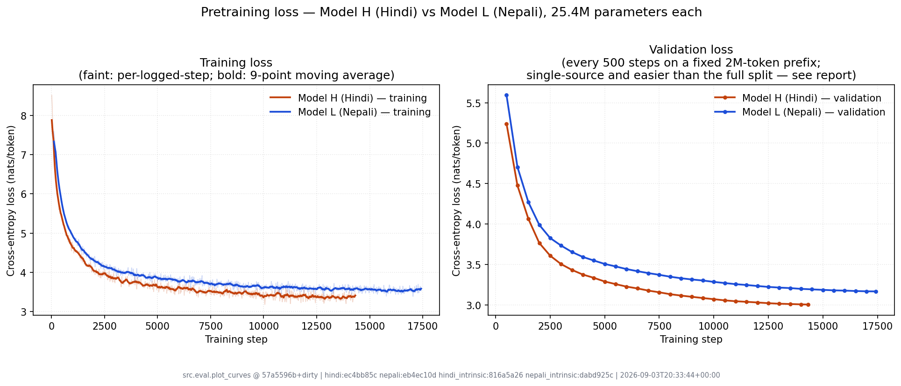

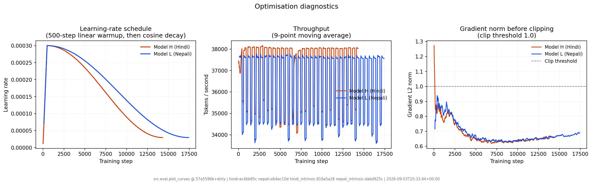

Both runs are stable: gradient norms sit near the 1.0 clip threshold without
spiking, throughput is flat at ~36.5k tok/s, and the loss falls monotonically.
Neither model shows any overfitting signature — validation loss decreased at
*every* one of the 29 and 35 evaluations, and the best checkpoint is the last
one in both runs.

Both models are therefore **data-limited, not converged**: they were still
improving when the one-epoch token budget ran out.

---

### 3.5 Why one epoch

Both models make exactly one pass over their training corpus. That is a
deliberate choice with three supports.

**The scaling-law argument.** Chinchilla (Hoffmann et al., 2022) found that for
a fixed compute budget, model size and training tokens should scale together,
with roughly **20 tokens per parameter** being compute-optimal. One epoch puts
both models close to that ratio:

| | Tokens | Parameters | Tokens / parameter |
| :--- | ---: | ---: | ---: |
| Model H | 468,638,315 | 25,379,840 | **18.5** |
| Model L | 571,113,472 | 25,379,840 | **22.5** |

The two bracket the optimum from either side. A 25M-parameter model trained on
~0.5B tokens is neither starved of data nor over-trained for its size, so the
comparison between H and L is not confounded by one model being closer to its
compute-optimal point than the other.

**The unique-data argument.** Large-scale pretraining conventionally prefers
fresh tokens to repeated ones: repetition yields diminishing returns and
increases memorisation of the training set. Our corpora were sized in Phase 1 to
hit ~500M tokens precisely so that a single pass would suffice.

**The empirical argument from this run.** The models show no sign of having
exhausted the data's usefulness — validation loss fell at every one of the 29
and 35 evaluations, and validation and test agree to three significant figures
(H: 26.77 / 26.80; L: 30.64 / 30.65). That is what a model that has seen each
token once looks like. A second pass is where memorisation would begin to show
as a widening validation-test gap.

**Why a second epoch was rejected rather than merely not attempted.** It would
not be a continuation. The cosine schedule has annealed to its 3.0e-5 floor by
step 14,329, so training onward at the floor learns almost nothing; a genuine
second epoch means a new schedule over 28,658 steps, i.e. **retraining from
scratch at twice the cost**. Extrapolating the late-run improvement rate
suggests perplexity would move from 26.77 to roughly 23 — real, but not
qualitatively different, and the brief attaches no marks to perplexity. The same
~4 GPU-hours were spent on the no-positional-embedding ablation (§7) instead,
which produced a finding rather than a slightly better number.

**One nuance worth stating**, because "Chinchilla-optimal" and "still improving"
sound contradictory and are not. Chinchilla describes how to *divide* a fixed
compute budget between parameters and tokens; it does not claim that a model at
that ratio has stopped benefiting from data. Both statements hold here: the
models sit near the compute-optimal split **and** were still improving when the
corpus ran out. The limitation in §9 is the second fact, not a violation of the
first.

---

### 3.6 Required deliverable — resource-level comparison

Every number below is read from the training logs
(`hindi/logs/train.jsonl`, `nepali/logs/train.jsonl`,
`hindi/logs/train_nopos.jsonl`), not estimated.

| | Model H (Hindi) | Model L (Nepali) | Ablation (Hindi, no positions) |
| :--- | ---: | ---: | ---: |
| Platform | Colab T4 (16 GB) | Kaggle T4 (16 GB) | Colab T4 (16 GB) |
| Micro-batch x accumulation | 16 x 4 | 32 x 2 | 16 x 4 |
| **Tokens per optimisation step** | **32,768** | **32,768** | **32,768** |
| Optimisation steps | 14,329 | 17,429 | 14,329 |
| Tokens consumed | 469,532,672 | 571,113,472 | 469,532,672 |
| Mean throughput | 36,898 tok/s | 36,457 tok/s | 34,856 tok/s |
| Peak GPU memory | 3.92 GiB | 7.36 GiB | 3.92 GiB |
| Validation passes | 29 | 35 | 29 |
| **Wall-clock** | **3.688 h** | **4.861 h** | **3.916 h** |
| Pure compute (tokens / throughput) | 3.535 h | 4.351 h | 3.742 h |
| Non-compute overhead | 4.2% | 10.5% | 4.4% |
| Effective yield | 127.3 Mtok / GPU-h | 117.5 Mtok / GPU-h | 119.9 Mtok / GPU-h |

**Total pretraining cost: 12.5 GPU-hours** across the two graded models and the
bonus ablation, all on free-tier 16 GB T4s.

**The comparison is controlled where it matters and confounded where it does
not.** Tokens per optimisation step is identical at 32,768, so both models take
the *same* optimisation step and the two runs differ only in how many of them
they take. Everything else in the table is a property of the platform, and
reading it as a property of the language would be wrong:

- **Peak memory (3.92 vs 7.36 GiB) is a batch-shape difference, not a language
  difference.** Model L uses a micro-batch of 32 where Model H uses 16, and
  activations scale linearly with it — the `(B, h, T, T)` attention matrices and
  the fp32-upcast `(B, T, V)` logits both double. Model H's 16 x 4 split was
  chosen first, conservatively; once it had proved that 16 fit in 3.9 GiB of
  14.6, Model L could safely take 32 x 2 and halve the number of sequential
  sub-batch passes per step. Neither model was memory-limited at the setting it
  ran at.
- **Throughput is effectively identical (36,898 vs 36,457 tok/s, a 1.2% spread)**,
  which is the expected result: the two models are the same shape, so a T4 does
  the same FLOPs per token for both. This is a useful negative control — it
  confirms that nothing about the Nepali data path (longer documents, different
  fertility) leaks into the training step's cost.
- **Wall-clock differs by 32% almost entirely because Model L consumes 21.6% more
  tokens**, plus a larger non-compute overhead. Model L trained on a corpus that
  over-delivered in Phase 1, so it took 3,100 more optimisation steps.
- **The overhead gap (10.5% vs 4.2%) is a storage-architecture difference.**
  Colab mounts Drive as a filesystem, so Model H's checkpoint writes land
  directly on the mount. Kaggle has no Drive mount and discards `/kaggle/working`
  when an interactive session dies, so every Model L checkpoint was additionally
  mirrored off-box with `rclone` (`mirror_to: gdrive:...` in
  `nepali/configs/train.yaml`). Thirty-five ~300 MB uploads over the network
  account for most of the difference. The extra 6 validation passes account for
  the rest.

**The ablation is slower than the baseline it ablates (3.916 h vs 3.688 h) despite
having 262,144 *fewer* parameters.** This is session variance between two
different Colab T4 allocations, not a cost of removing positional embeddings —
the position lookup is a single embedding gather, well under 0.1% of the step.
It is recorded here rather than smoothed over because it sets the noise floor for
any wall-clock claim in this report: **differences below roughly 6% between runs
on free-tier hardware are not measurable**, which is why §7 compares the ablation
on loss and attention statistics and makes no timing claim.


## 4. Intrinsic Evaluation

### 4.1 Results

Measured over the **complete** validation and test splits by
`src/eval/intrinsic.py`, striding in non-overlapping 512-token windows so every
token is predicted exactly once, with token-weighted averaging so the short
final batch does not bias the mean. 58M tokens scored in total.

| Metric | Model H (Hindi) | Model L (Nepali) |
| :--- | ---: | ---: |
| Validation cross-entropy (nats) | 3.2874 | 3.4224 |
| Validation perplexity | **26.77** | 30.64 |
| Test cross-entropy (nats) | 3.2885 | 3.4228 |
| **Test perplexity** | **26.80** | 30.65 |
| **Test bits-per-byte** | 0.5371 | **0.4495** |
| **Test bits-per-character** | 1.3636 | **1.1964** |
| Bytes / token | 8.833 | 10.985 |
| Characters / token | 3.479 | 4.127 |

Validation and test agree to three significant figures for both models, which is
what a model that has not memorised its validation set looks like.

`PPL = exp(CE)`; `BPB = CE_nats / (ln2 × bytes_per_token)`;
`bits/char = CE_nats / (ln2 × chars_per_token)`.

### 4.2 Required discussion — the H-vs-L gap

**Hindi wins perplexity by 14.4%. Nepali wins bits-per-byte by 19.5% and
bits-per-character by 14.0%.** Both statements are true, and reading either one
alone gives the wrong answer.

The cause is **tokenizer fertility**. Nepali's 8k BPE packs 4.127 characters per
token against Hindi's 3.479 — 18.6% more text behind each token. Predicting a
Nepali token is therefore a strictly harder problem than predicting a Hindi one,
because it commits to more of the underlying string. Per-token perplexity
charges Nepali for that; per-character and per-byte normalisation credit it.

This is exactly why the brief requires BPB "to make the two languages more
comparable when tokenizers differ". The naive reading — *"Hindi is the better
model because its perplexity is lower"* — is wrong, and the metric that says so
is the one the brief asks for.

**BPB is not fully neutral either.** Nepali averages 10.985 bytes/token against
Hindi's 8.833, so part of Nepali's BPB advantage is UTF-8 encoding density
rather than model quality. Both languages use Devanagari, where a character
costs ~3 bytes, so the byte normaliser is not comparing like with like across
*scripts* even though it does better than perplexity across *tokenizers*.
**Bits-per-character is the fairest of the three here**, since the two languages
share a script but not a tokenizer, and it still favours Nepali, by a smaller
margin (14.0% rather than 19.5%).

**Why is the lower-resource language ahead on the fairest metric?** Because "L"
denotes the language's resource level in the world, not the size of this corpus.
Model L actually trained on *more* tokens (571M vs 469M) and more characters
(2.61B vs 1.81B), because Phase 1's Nepali collection over-delivered. What Nepali
has less of is *diversity of provenance*: its manual share is 21.20% against
Hindi's 26.87%, and `sangraha` accounts for 77.5% of its validation documents
against 71.6% for Hindi. A corpus concentrated in one source is more
self-similar and therefore easier to model per character. The bits-per-character
gap should be read as partly a statement about corpus homogeneity, not purely
about language or model quality.

**What this comparison does not control for.** The two models are identical in
shape and were trained with identical hyperparameters, so capacity and
optimisation are controlled. Everything else — corpus size, provenance mix,
tokenizer fertility, domain balance — differs simultaneously. With two runs there
is no way to attribute the gap to any single factor, and no error bars: each
number is a single run with a single seed.

### 4.3 A measurement bias found during evaluation

**The perplexity reported during training was optimistic by about 30%, and this
report quotes the corrected figures throughout.**

The training loop validated on `val_tokens: 2000000` — a fixed 2M-token
*prefix* of the validation split. The Phase 1 splits are written grouped by
source. Sampling the split at several byte offsets confirms the ordering:

| Offset into Hindi `val.jsonl` | Dominant sources |
| :--- | :--- |
| 0 MB | Hindi wikibooks, Hindi wikiquote |
| 5 MB | Hindi News Crawl |
| 10–18 MB | manual web crawl (amarujala, indiatv, livehindustan) |
| 120 MB, 230 MB | `sangraha` |

A 2M-token slice is roughly the first 17.7 MB, so it never reaches `sangraha` —
which is **71.6%** of Hindi validation documents and **77.5%** of Nepali's. The
training curve was scoring the small, clean, encyclopaedic head of the split.

| | Training-time (2M prefix) | Full validation split | Gap |
| :--- | ---: | ---: | ---: |
| Model H | 20.19 | 26.77 | +32.6% |
| Model L | 23.77 | 30.64 | +28.9% |

**Checkpoint selection is unaffected.** Validation loss was *strictly*
monotonic — zero increases across 29 and 35 evaluations — so the best checkpoint
is the final one under any consistent measure, biased or not.

**The training curve remains the right thing to plot**, because it is a
*consistent* progress signal across steps, which is all a training curve needs to
be, and it is what checkpoint selection actually used.
`report/figures/val_perplexity.png` plots the curve together with the true
full-split value as a star at the final step, with the gap annotated, rather than
quietly substituting one number for the other.

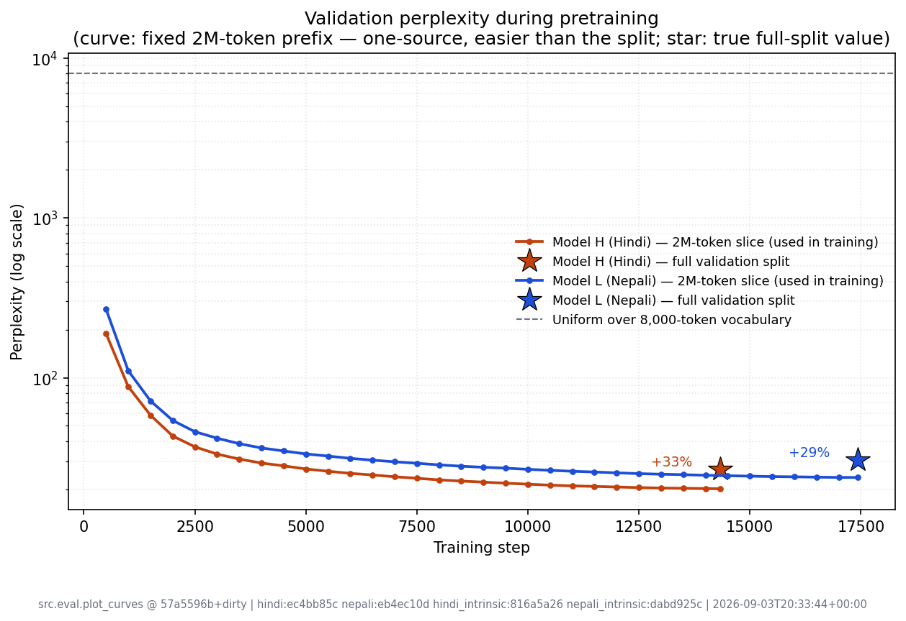

The fix for a future run is to sample the validation slice at random offsets
across the split rather than taking a prefix, or to shuffle documents before
writing splits. Doing so now would require re-running both trainings to keep the
curves comparable, which the remaining budget does not allow.

---

## 5. Generation

`src/eval/generate.py` draws 32 prompts per language by seeded reservoir
sampling over the held-out **test** split — a single streaming pass, so the
draw is uniform over every eligible document without loading a 250 MB file, and
reproducible so neither model gets an easier prompt set. Each prompt is 32
tokens; 128 new tokens are generated under greedy decoding and temperature
0.5 / 1.0 / 1.5. The true continuation is stored beside each generation, so §5.2
needs no second GPU pass.

### 5.1 Samples

The full set is in `hindi/samples/generations.md` and
`nepali/samples/generations.md`. One Hindi prompt, quoted verbatim:

> **Prompt** — `India News (इंडिया न्यूज) Gujrat High Court Recruitment 2023, दिल्लीः यदि`
>
> **Reference** — आप एक अच्छी नौकरी की तलाश कर रहे हैं तो ये आपके लिए एक अच्छी खबर है। गुजरात उच्च न्यायालय (Gujarat High Court) ने एक भर्ती नोटिफिकेशन जारी किया है।
>
> **Greedy** — आप भी अपने घर में किसी भी तरह की कोई भी चीज खरीदना चाहते हैं तो आप अपने घर में किसी भी तरह की कोई भी चीज खरीद सकते हैं। अगर आप भी अपने घर में किसी भी तरह की कोई चीज खरीदना चाहते हैं तो आप अपने घर में किसी भी तरह की कोई चीज खरीद सकते हैं। *(repeats to the token limit)*
>
> **Temperature 0.5** — आप भी इस विषय पर कुछ बातें करना चाहते हैं, तो हम आपको बताने जा रहे हैं कि इस विषय में क्या आपको बता रहे हैं। … - इसके बाद आप अपने बारे में विस्तार से बताएं। *(clause repeats)*
>
> **Temperature 1.0** — आप भी इस विषय पर कुछ अध्ययन करना चाहते हैं, तो हम आपको यहां कुछ प्रोफेसर पद के बारे में बताएंगे. - इस सेक्टर से जुड़े 10 बड़े शिक्षण संस्थानों के 10 बड़े स्टडीज से काफी मिल रहे हैं. *(terminates with `<eos>` after 106 tokens)*
>
> **Temperature 1.5** — शादी-च्छिंग साउथ कुछ पुरानी भरी यारा राजनीतिक पार्टी बनती है तोवत धर्म नई आवश्यकता ही बताऊंगी. दरअसल सौराष्ट्र से बराबरी नगरी लगनेों पर हिंदू ट्वीट किया है.

### 5.2 Metrics

All metrics are implemented from their definitions in `src/eval/metrics.py` —
no metric library — and unit-tested against hand-computed values. Words are
maximal non-whitespace runs with leading/trailing punctuation split off;
Python's `\w` is unusable here because Devanagari vowel signs are combining
marks (category `Mn`) and are not alphanumeric, so `\w+` would tear the matras
off their consonants.

**Model H (Hindi)**

| Decoding | BLEU-4 | chrF++ | ROUGE-L | rep-1 | rep-4 | Distinct-1 | Distinct-2 | `<eos>` % |
| :--- | ---: | ---: | ---: | ---: | ---: | ---: | ---: | ---: |
| greedy | 1.47 | 11.53 | 11.74 | 84.0 | 80.9 | 7.8 | 13.7 | 3 |
| temp 0.5 | **2.21** | 14.57 | 13.28 | 66.7 | 46.5 | 17.1 | 37.0 | 25 |
| temp 1.0 | 1.42 | **18.94** | **13.64** | 27.6 | 0.7 | 42.7 | 85.6 | 16 |
| temp 1.5 | 0.51 | 16.08 | 7.91 | 8.0 | 0.0 | 68.6 | 97.8 | 12 |
| *held-out human* | — | — | — | *31.7* | *2.8* | *40.5* | *83.5* | — |

**Model L (Nepali)**

| Decoding | BLEU-4 | chrF++ | ROUGE-L | rep-1 | rep-4 | Distinct-1 | Distinct-2 | `<eos>` % |
| :--- | ---: | ---: | ---: | ---: | ---: | ---: | ---: | ---: |
| greedy | 2.01 | 14.69 | 10.27 | 77.7 | 71.4 | 11.8 | 17.5 | 12 |
| temp 0.5 | **2.49** | 16.16 | **11.09** | 49.1 | 26.2 | 28.3 | 48.4 | 38 |
| temp 1.0 | 2.06 | **19.26** | 10.70 | 14.3 | 0.0 | 61.5 | 91.8 | 44 |
| temp 1.5 | 0.24 | 18.26 | 4.53 | 3.7 | 0.0 | 78.6 | 99.0 | 3 |
| *held-out human* | — | — | — | *22.4* | *0.5* | *56.2* | *88.9* | — |

### 5.3 Required discussion — is each metric informative here?

**BLEU-4: barely informative, and actively misleading if read as quality.**
These are open-ended continuations, not translations. There is one reference and
no reason the model should reproduce it: any fluent, on-topic continuation that
uses different words scores zero. The absolute numbers confirm it — 4-gram
precision is 0.0–1.3% everywhere, so BLEU is dominated by its unigram term.
Worse, its *ordering* is perverse: BLEU peaks at temperature 0.5, the setting
whose text visibly repeats itself, because hedging towards frequent words raises
n-gram overlap with any reference. A metric that ranks a partially degenerate
sampler above a coherent one is not measuring what we care about. It is reported
because the brief requires it, and because that failure is itself the finding.

**chrF++: the most informative of the three reference-based metrics.** Character
n-grams give partial credit for the right stem under the wrong inflection, which
matters enormously in two heavily inflected languages where a word-level match
demands the exact case and agreement suffix. chrF++ ranks the settings the way a
reader does: temperature 1.0 highest for both models (18.94 / 19.26), greedy
lowest (11.53 / 14.69). It still cannot reward a continuation that is good but
lexically unrelated to the reference, so its absolute level is not meaningful —
only the ordering is.

**ROUGE-L: weakly informative, and it inherits BLEU's problem.** LCS rewards
in-order matches that need not be contiguous, which is a slightly better fit for
free continuation than n-gram precision. But it still assumes the reference is
the target, which here it is not. Its precision/recall split does say something:
Nepali's temperature 0.5 has ROUGE-L precision 21.3 against recall 9.7, i.e. it
generates short (length ratio 0.74) and safe.

**Repetition rate: the most informative metric in this table.** It needs no
reference, so it is immune to the "one arbitrary continuation" problem, and it
separates the settings by an order of magnitude. Greedy repeats 80.9% of its
4-grams (Hindi) against 2.8% for real human text — a 29× excess that BLEU barely
registers, because a repeated phrase can still contain reference n-grams.

**Distinct-1/2: informative, with a caveat.** Read against the human control it
is sharp: temperature 1.0 gives Distinct-2 of 85.6% against the corpus's own
83.5%, meaning the model's lexical diversity matches its training distribution
almost exactly. This is what maximum-likelihood training predicts — sampling at
temperature 1.0 samples from the learned distribution. The caveat is that
Distinct-n falls as sample count and length grow, so it is comparable only
across sets of equal size and length, which is the case here by construction.

**The control row is what makes any of this readable.** "Distinct-2 of 85.6%"
means nothing alone; "85.6% against the corpus's own 83.5%" is a finding.
Scoring the held-out human continuations under the same tokenisation costs
nothing and converts every reference-free number into a comparison.

### 5.4 Required discussion — qualitative coherence

The generated Hindi and Nepali are **fluent at the phrase level, coherent for one
or two clauses, and incoherent beyond that.** Morphology and agreement are
essentially always right; the text reads as Devanagari a native speaker would
accept as well-formed. What fails is discourse: the model does not carry the
prompt's topic forward.

The Hindi example above is characteristic. The prompt is a Gujarat High Court
recruitment notice. Every setting produces grammatical Hindi; none produces
anything about a recruitment notice. Temperature 1.0 drifts to an adjacent
register — education, institutions, professorships — which is topically closer
than the others but still not the prompt's subject. This is the expected
behaviour of a 25M-parameter model trained on 0.5B tokens for one epoch: enough
capacity for syntax and local collocation, not enough for topic tracking.

**Decoding changes the failure mode, not the competence.**

* *Greedy* collapses into a loop within ~20 tokens and never escapes, because
  the argmax of a distribution the model has already conditioned on is
  self-reinforcing. Only 3% (Hindi) of greedy samples ever emit `<eos>`.
* *Temperature 0.5* delays the collapse rather than avoiding it — the Nepali
  sample degenerates into a comma-separated list of ministry names.
* *Temperature 1.0* is the only setting producing text a reader would call
  natural, and it is also the only one that terminates properly (16% / 44%
  `<eos>` rate) — the model has genuinely learned where documents end.
* *Temperature 1.5* is fluent word salad: locally well-formed, semantically
  arbitrary, with rare tokens surfacing that the corpus barely supports.

The `<eos>` rates deserve note. Nepali terminates far more often than Hindi
(44% vs 16% at temperature 1.0), consistent with its shorter mean document
length and more homogeneous corpus.

---

## 6. Attention Analysis

`src/eval/attention_analysis.py` accumulates four per-head statistics over 32
held-out windows — 16,352 query positions, not the single sentence in the
heatmaps — and draws heatmaps for an early, a middle, and a late layer. Query
position 0 is excluded from every average: it can attend only to itself, so its
entropy and distance are 0 for every head and would drag all heads towards the
same uninformative value.

| Statistic | Definition | Reads as |
| :--- | :--- | :--- |
| Mean distance | `Σⱼ pᵢⱼ (i − j)`, averaged over queries | how far back a head looks |
| Normalised entropy | `H / log(i+1)` | 0 = picks one token, 1 = uniform |
| Previous-token mass | `p_{i,i−1}` | structural/positional behaviour |
| First-position mass | `p_{i,0}` | attention-sink / idle head |

Normalisation matters: a query at position *i* can attend to only *i + 1*
positions, so raw entropy grows with position and conflates head behaviour with
where in the sequence it is measured.

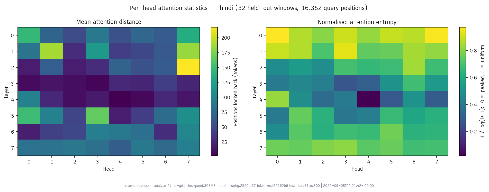

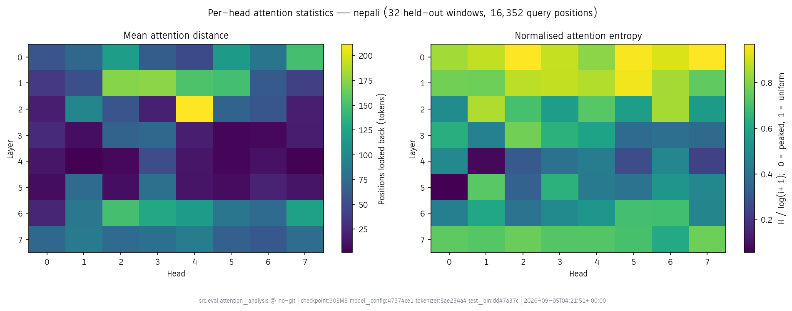

### 6.1 Required discussion — local/positional vs content-based heads

**Model H (Hindi), selected layers**

| Layer | Head | Distance | Norm. entropy | Prev-token | Sink | Reading |
| ---: | ---: | ---: | ---: | ---: | ---: | :--- |
| 0 | 0 | 145.6 | 0.97 | 0.01 | 0.02 | diffuse |
| 0 | 7 | 135.1 | 0.96 | 0.01 | 0.01 | diffuse |
| 4 | 4 | **1.7** | **0.02** | **0.96** | 0.00 | previous-token |
| 4 | 2 | 9.8 | 0.36 | 0.13 | 0.01 | local |
| 4 | 0 | 96.6 | 0.83 | 0.02 | 0.05 | long-range |
| 7 | 7 | 94.9 | 0.69 | 0.02 | 0.09 | content-based |

Across all 64 heads: **39 content-based, 16 diffuse, 6 previous-token, 3 local**
(Hindi); **37, 15, 8, 4** (Nepali).

**Layer 0 is uniformly diffuse.** Every head has normalised entropy 0.80–0.97
and mean distance 49–150 tokens. With only one layer of processing the residual
stream still carries little more than token identity plus position, so there is
nothing yet to select *on* — a head at this depth is close to averaging its
context. This is positional in the weak sense that it depends on where things
are, but it is not doing a specific structural job.

**Layer 4 is where specialisation appears, and it is sharp.** Hindi head 4 places
**96% of its mass on position *i − 1***, with mean distance 1.7 and normalised
entropy 0.02 — an almost pure previous-token head, the classic induction-adjacent
circuit. Nepali independently learns the same thing at layer 4 head 1 (84%
prev-token mass, distance 1.5, entropy 0.08). Around it sit several
short-range heads (distance 3–15, prev-mass 0.30–0.40) and one long-range head
(Hindi head 0: distance 96.6, entropy 0.83). **Two models sharing no data, no
vocabulary and no weights arrive at the same structure at the same depth**,
which is decent evidence that this is a property of the objective and the
architecture rather than of either corpus.

**Layer 7 broadens again into content-based selection.** Distances return to
59–95 tokens, but normalised entropy is 0.61–0.81 — clearly below layer 0's
0.80–0.97 at comparable distance. A head that reaches far *and* stays peaked is
not attending by offset; it is selecting particular earlier tokens, which is the
signature of content-based attention. Attention-sink mass also rises here (0.04
–0.10 against 0.01–0.02 in layer 0): late heads park unneeded probability mass on
the first token, an established mechanism that lets a head contribute nearly
nothing when it has nothing to add.

**The overall picture** is the standard one: early layers aggregate broadly,
middle layers build local and positional structure, late layers select on
content. The distinction between "long-range" and "content-based" cannot be made
from mean distance alone — a diffuse head and a selective long-range head can
report the same distance — which is why entropy and sink mass are reported
alongside it. Layer 0 head 0 and layer 7 head 7 have similar distances (145.6 vs
94.9) and completely different characters (entropy 0.97 vs 0.69).

**Caveat on the classification.** The thresholds in `classify_head` (sink > 0.5,
prev-token > 0.25, local < 2% of context, diffuse > 0.8 normalised entropy) are
crude and chosen to make 64 heads discussable, not to support a scientific
claim. "Content-based" is the residual category — concentrated but not on a
fixed offset — and should be read as "not obviously positional" rather than as a
positive identification.

### 6.2 Required discussion — how Model H and Model L differ

The brief asks how the two models' attention differs. The honest headline is
**they barely do**, and the near-identity is more interesting than any gap.

| Aggregated over all 64 heads | Model H | Model L |
| :--- | ---: | ---: |
| Mean attention distance | 65.6 | 63.3 |
| Mean normalised entropy | 0.643 | 0.624 |
| Mean previous-token mass | 0.095 | 0.109 |
| Mean first-position (sink) mass | 0.061 | 0.057 |

Two models sharing no data, no vocabulary and no weights land within 4% of each
other on every aggregate. Whatever these statistics measure, it is dominated by
the objective and architecture rather than by the corpus.

The differences appear layer by layer, and they are of *phase*, not of kind:

| Layer | H distance | L distance | H prev-token | L prev-token | H sink | L sink |
| ---: | ---: | ---: | ---: | ---: | ---: | ---: |
| 0 | 85.4 | 88.6 | 0.02 | 0.02 | 0.013 | 0.012 |
| 1 | 94.5 | 105.4 | 0.03 | 0.02 | 0.073 | 0.067 |
| 2 | 67.4 | 68.8 | 0.10 | 0.08 | 0.078 | 0.069 |
| 3 | **19.0** | 27.9 | **0.22** | 0.16 | 0.033 | 0.037 |
| 4 | 24.7 | **13.4** | 0.29 | 0.31 | 0.024 | 0.026 |
| 5 | 88.2 | **28.8** | 0.04 | **0.21** | **0.163** | 0.025 |
| 6 | 63.2 | 98.3 | 0.04 | 0.03 | 0.056 | **0.156** |
| 7 | 82.6 | 75.5 | 0.02 | 0.02 | 0.048 | 0.061 |

Both models trace the same arc — diffuse early, local in the middle, broad
again late — but Nepali's local phase sits one layer deeper and lasts longer.
Hindi's trough is layers 3–4 and is over by layer 5, where its heads jump back
to distance 88.2 and dump 16.3% of their mass on the first position: layer 5 is
largely an idle layer in Model H. Nepali is still doing local work at layer 5
(distance 28.8, previous-token mass 0.21) and only parks mass on the sink at
layer 6.

Counting heads rather than averaging says the same thing: **Model L devotes more
machinery to local structure** — 10 heads with mean distance under 10 tokens
against Model H's 6, and 8 previous-token heads against 6.

**A plausible link to §4.2, offered as a hypothesis and not a result.** Nepali's
tokenizer packs 4.127 characters per token against Hindi's 3.479, so a Nepali
token is a larger linguistic unit and more of the morphology that Hindi spreads
across several tokens is compressed inside one. More local heads would be a
sensible response to that. But this is two models, one seed each, with no
ablation isolating fertility from every other difference between the corpora,
and the aggregate statistics are nearly identical. The layer-5/6 divergence could
equally be initialisation noise. It is a direction for a controlled experiment —
train Model H with a Nepali-fertility tokenizer — not a conclusion.

### 6.3 Heatmaps

Heatmaps for layers 0, 4 and 7 across heads 0, 1, 4 and 7, drawn on a real
40-token held-out passage. The passage is listed token by token in
[`figures/hindi_attention_passage.txt`](figures/hindi_attention_passage.txt) and
[`figures/nepali_attention_passage.txt`](figures/nepali_attention_passage.txt).

**Model H (Hindi)**

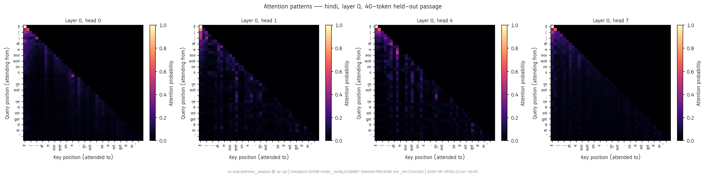
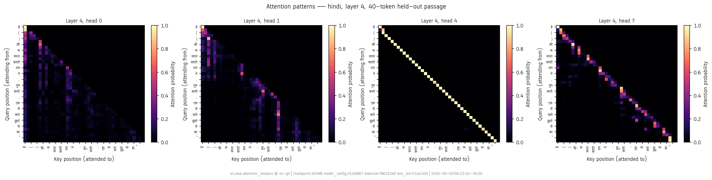
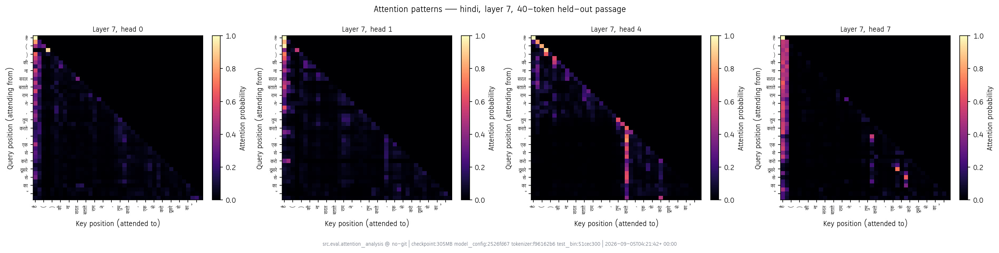

**Model L (Nepali)**

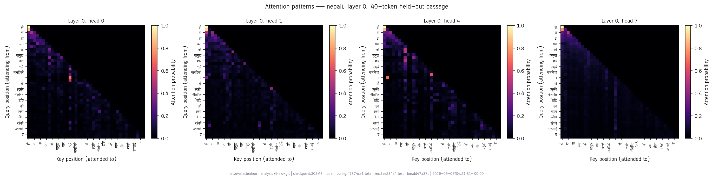
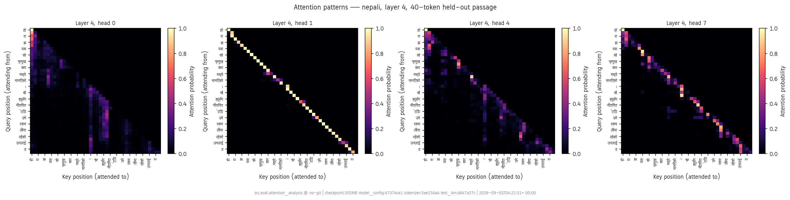
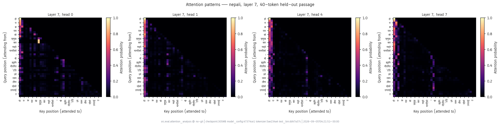

Head 4 is included deliberately: it is the 96% previous-token head of §6.1, and
in `hindi/figures/attention_layer4.png` it appears as a single unbroken
sub-diagonal stripe at near-1.0 probability — the cleanest structure anywhere in
either model. Beside it, head 0 of the same layer is a broad lower-triangular
wash and head 7 shows scattered vertical stripes at particular key positions,
the visual signature of content-based selection. The three sit in one figure, so
the difference between positional, diffuse and content-based attention can be
read off directly rather than inferred from the statistics table.

Axis labels are rendered in Lohit Devanagari. Colab's package index has no
`fonts-noto-devanagari`; `fonts-indic` provides Lohit and Samyak, and
`attention_analysis.py` locates them by scanning the filesystem rather than
trusting matplotlib's font cache, which is written once per process and does not
see a font installed after a subprocess starts.

---

## 7. Bonus Ablation — No Positional Embeddings

Self-attention is permutation invariant, so the standard account is that
positional embeddings are what let a Transformer know word order at all. This
ablation removes them and measures what actually breaks.

### 7.1 Setup

`hindi/configs/model_nopos.yaml` differs from the graded model's config in
exactly one field, `pos_encoding: learned -> none`, which removes the 512 x 512
learned position table: 25,379,840 -> **25,117,696** parameters. The training
config is otherwise byte-identical to `train.yaml` — same seed, same optimiser,
same 32,768 tokens per step, same 14,329 steps over the same 468,638,315 tokens,
same cosine schedule. Wall-clock 3.92 h against the baseline's 3.69 h.

Three controls, because an ablation is only worth reading if the single
intended variable is the only one that moved:

* **The configs were asserted equal before training**, field by field, so a
  stray edit could not silently become a second variable.
* **The learning-rate schedules were verified to coincide**, not assumed:
  `src/eval/compare_ablation.py` compares the logged LR at every shared step and
  reports the maximum relative difference, which came out **0.0000** across 716
  points. This mattered — `max_steps` originally drove both the schedule horizon
  and the stopping point, so a shortened ablation would have trained at a tenth
  of the baseline's learning rate by step 2,000 and the whole comparison would
  have measured that instead. The two keys are now separable
  (`schedule.total_steps`), and the check exists so the confound cannot return
  unnoticed.
* **The checkpoint is 3,146,872 bytes smaller** than the baseline's. If the
  262,144-parameter table is genuinely absent, the saving should be its weight
  plus Adam's two moment buffers: 262,144 x 4 x 3 = 3,145,728 bytes. The
  1,144-byte remainder is metadata. The table is not merely zeroed or unused —
  it is gone.

### 7.2 What it costs

Full held-out splits, same evaluation code as the graded model:

| Test split | Learned positions | No positions | Change |
| :--- | ---: | ---: | ---: |
| Cross-entropy (nats) | 3.2885 | 3.3216 | +0.0331 |
| **Perplexity** | **26.80** | **27.70** | **+3.4%** |
| Bits-per-byte | 0.5371 | 0.5425 | +1.0% |
| Bits-per-character | 1.3636 | 1.3773 | +1.0% |

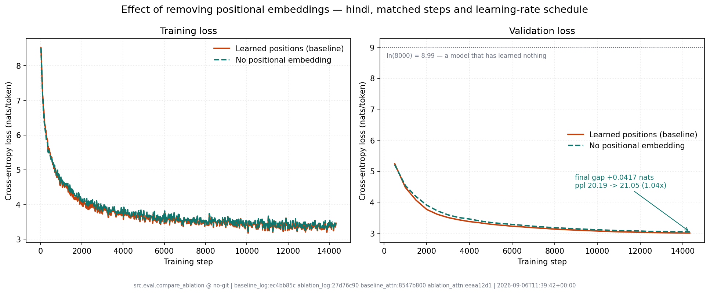

**Removing positional embeddings entirely costs about 3.4% perplexity.** The
curves are nearly superimposed: the ablation is visibly worse for the first
~3,000 steps and then closes most of the gap. For scale, the distance from the
baseline to a model that has learned nothing (`ln 8000 = 8.99`) is 5.70 nats;
the ablation gives up 0.033 of that, or **0.6% of everything the baseline
learned**.

**Generation metrics, both models, all four decoding settings.** The bonus asks
for the full evaluation suite, so the whole table is reproduced here; it is
generated by the same `src/eval/metrics.py` invocation that scored the graded
models, from 32 held-out prompts with a 32-token prefix and 128 new tokens
(`report/figures/generation_metrics_ablation.md`).

| Decoding | | BLEU-4 | chrF++ | ROUGE-L | rep-1 | rep-4 | Distinct-1 | Distinct-2 |
| :--- | :--- | ---: | ---: | ---: | ---: | ---: | ---: | ---: |
| greedy | learned | 1.47 | 11.53 | 11.74 | 84.0 | 80.9 | 7.8 | 13.7 |
| | *no positions* | 1.62 | 11.91 | 12.81 | 74.4 | 72.3 | 7.4 | 13.3 |
| T = 0.5 | learned | 2.21 | 14.57 | 13.28 | 66.7 | 46.5 | 17.1 | 37.0 |
| | *no positions* | 1.53 | 13.78 | 13.55 | 60.9 | 40.2 | 16.4 | 35.4 |
| T = 1.0 | learned | 1.42 | 18.94 | 13.64 | 27.6 | 0.7 | 42.7 | 85.6 |
| | *no positions* | 1.75 | 18.03 | 13.30 | 26.4 | 1.4 | 42.9 | 84.9 |
| T = 1.5 | learned | 0.51 | 16.08 | 7.91 | 8.0 | 0.0 | 68.6 | 97.8 |
| | *no positions* | 0.75 | 16.50 | 7.22 | 7.1 | 0.1 | 69.7 | 98.2 |
| *held-out reference* | | -- | -- | -- | 31.7 | 2.8 | 40.5 | 83.5 |

**Generation is essentially unchanged.** chrF++ at temperature 1.0 falls from
18.94 to 18.03, and every diversity statistic stays within noise of the baseline
at every setting — Distinct-2 84.9 against 85.6, rep-4 1.4% against 0.7%, both
still tracking the human reference's 83.5 and 2.8%. The ablated model even wins
BLEU-4 and ROUGE-L at three of the four settings, which says more about those
metrics on open-ended generation (§5.3) than about the ablation. The same
degeneracy structure survives too: greedy collapses (rep-4 72.3%), temperature
1.0 matches the corpus, temperature 1.5 over-diversifies.

The ablated model writes recognisably the same kind of Hindi.

### 7.3 What breaks — and what does not

The prediction going in was specific: a **previous-token head** should be unable
to form, because "previous" is exactly what a model with no position signal
cannot identify. The baseline's cleanest structure is one of these — layer 4,
head 4, with 96% of its attention mass on position *i-1*.

**That prediction was wrong, and the way it was wrong is the finding.**

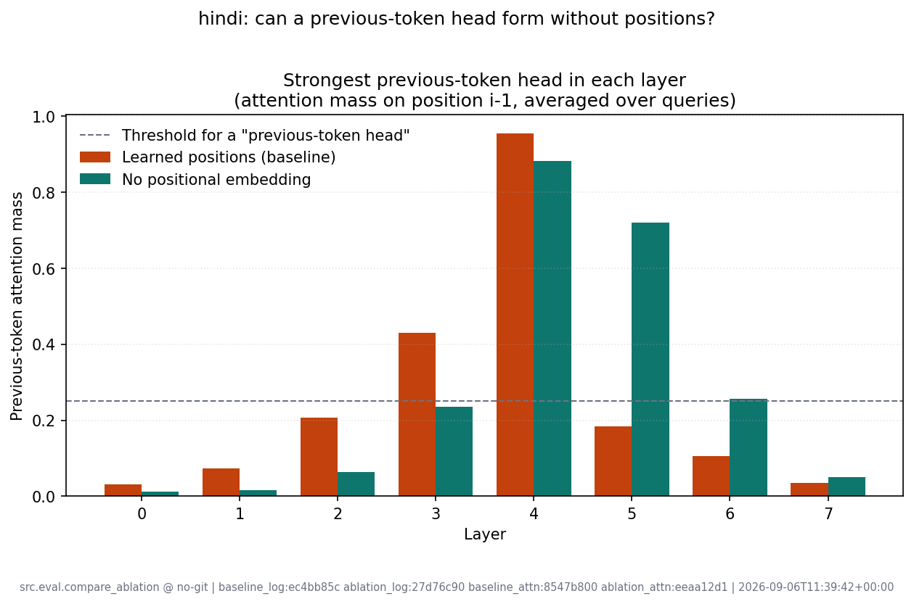

| | Learned positions | No positions |
| :--- | ---: | ---: |
| Strongest previous-token head | 0.96 (L4 H4) | **0.88 (L4 H7)** |
| Second strongest | 0.43 (L3 H3) | **0.72 (L5 H3)** |
| Heads with prev-token mass > 0.25 | 6 | 5 |

The ablated model builds a previous-token head anyway, at 88% mass in the same
layer, and a second one at 72% in the layer below. Nothing in its architecture
tells it where token *i-1* is; it reconstructs that.

The two heatmaps below are the same layer on the same held-out passage. In the
baseline, head 4 is an unbroken sub-diagonal stripe; in the ablation, head 7 is
the same structure at 88% mass, built with no position table at all.

**Baseline — learned positions**


**Ablation — no positional embedding**

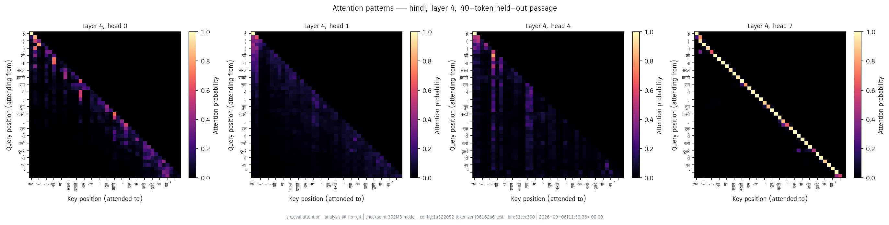

Per-head statistics across all eight layers, for both models:

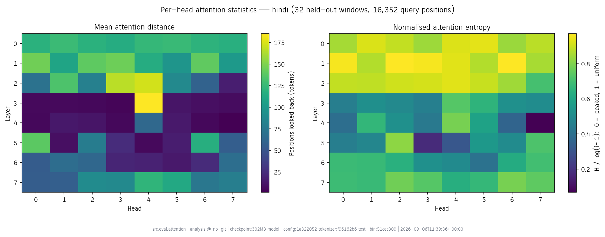

**How.** The causal mask is itself a position signal. A query at position *i*
attends over exactly *i + 1* keys, so the number of visible tokens — and hence
the normalisation of the softmax — varies monotonically with position. A
decoder-only model is never truly order-blind; removing the embedding replaces
an explicit position signal with an implicit and weaker one, and 3.4% perplexity
is the price of that substitution rather than the price of losing position
altogether. This reproduces a known result in the literature on decoder-only
models trained without positional encodings.

**What does change is where the work happens.**

| Aggregated over 64 heads | Learned positions | No positions |
| :--- | ---: | ---: |
| Mean attention distance | 65.6 | 71.3 |
| Mean normalised entropy | 0.643 | 0.689 |
| Heads with mean distance < 10 | 6 | **12** |
| Diffuse / content-based / local / prev-token | 16 / 39 / 3 / 6 | **24 / 26 / 9 / 5** |

Layer by layer, the ablated model is markedly **more diffuse early** (mean
distance 121.1 against 85.4 at layer 0; 124.2 against 94.5 at layer 1) and
markedly **more local in the middle** (14.8 against 24.7 at layer 4; 55.7
against 88.2 at layer 5). The reading that fits: with no position embedding to
read off, the early layers cannot select on position, so they aggregate broadly
— and that broad aggregation is plausibly where the implicit position signal
gets assembled. Only once it exists can the middle layers do the local,
offset-sensitive work, which they then do harder than the baseline does.

The cost shows in the head census: **content-based heads fall from 39 to 26**
while diffuse and local heads rise. Capacity that the baseline could spend
selecting on *what* tokens are, the ablated model must spend working out *where*
they are.

### 7.4 What breaks without position information — the short answer

Less than the textbook framing suggests, in a decoder-only model. Order
information is not lost, because the causal mask encodes it implicitly; it
becomes more expensive to use. The model pays 3.4% perplexity, reallocates about
a fifth of its heads from content-based selection to diffuse aggregation and
local scanning, and still constructs a previous-token head at 88% mass. An
encoder — bidirectional, with no causal mask — would have no such fallback, and
would be genuinely permutation invariant.

### 7.5 Limitations

One seed, one language, one architecture. The 3.4% gap is a single measurement
with no estimate of run-to-run variance, so it should be read as "small" rather
than as precisely 3.4%. The attention reorganisation is a larger effect and more
robust to that concern, but the causal story — early layers assembling an
implicit position signal — is an interpretation of correlational evidence, not
something this experiment isolates.

## 8. Reproducibility

Every evaluation artefact carries a provenance block (`src/eval/provenance.py`)
recording the exact command, the git commit and branch, whether the tree was
dirty, library versions, and a SHA-256 for each input file. Figures carry a
condensed version of the same line drawn into the image, so a figure pasted into
a document still says which run produced it.

```
src.eval.plot_curves @ 57a5596b+dirty | hindi:ec4bb85c nepali:eb4ec10d | 2026-09-03T20:33:44+00:00
```

The chain is: committed `train.jsonl` → committed script → figure, with digests
linking each step. What this does *not* claim is that the pretraining itself is
reproducible from the repository: that took ~8.5 GPU-hours and depends on
non-deterministic fp16 kernel scheduling. The reproducibility guarantee is over
the analysis, given the logs and checkpoints.

Artefacts, all committed:

| Path | Contents |
| :--- | :--- |
| `{lang}/logs/train.jsonl` | Per-step training log |
| `{lang}/eval/intrinsic.json` | CE, PPL, BPB, bits/char, val + test |
| `{lang}/eval/attention_stats.json` | Per-head statistics, all 64 heads |
| `{lang}/samples/generations.{json,md}` | 32 prompts × 4 settings, with references |
| `{lang}/figures/attention_*.png` | Heatmaps and per-head summary |
| `report/figures/*.png` | Loss, perplexity, optimisation diagnostics |
| `report/figures/generation_metrics.{json,md}` | §5.2 tables |

`notebooks/evaluate_colab.ipynb` reproduces every one of them in a single GPU
session.

---

## 9. Limitations

1. **One seed, two runs.** No error bars anywhere. Every difference quoted
   between Model H and Model L is a single-sample comparison, and the ~14%
   metric gaps come with no estimate of run-to-run variance. (The single *epoch*
   is a justified design choice rather than a limitation — see §3.5 — but the
   single *seed* is a genuine constraint of the compute budget.)
2. **The validation slice was unrepresentative during training** (§4.3). It did
   not affect checkpoint selection, but it means the training curve and the
   reported metrics measure different things, and the curve cannot be compared
   directly against the final numbers.
3. **Both models are data-limited, not converged.** Validation loss was still
   falling at the final step. Roughly 20 tokens per parameter is near the
   Chinchilla-optimal ratio for compute, but not the point of diminishing returns
   for quality.
4. **The H-vs-L comparison confounds several variables at once** — corpus size,
   provenance mix, tokenizer fertility, domain balance — so the gap cannot be
   attributed to any one of them (§4.2).
5. **Generation is evaluated on 32 prompts per model.** Adequate for the
   order-of-magnitude differences between decoding settings; far too few to
   support a fine-grained claim.
6. **Attention statistics come from 32 windows of one split**, and the head
   classification thresholds are heuristic (§6.1).
7. **The ablation is a single run of a single language** (§7.5). The 3.4%
   perplexity gap has no error bars, and the account of *why* the attention
   reorganises is an interpretation of correlational evidence rather than
   something the experiment isolates.

---

## 10. Conclusion

Two 25.4M-parameter decoder-only Transformers were implemented from primitive
PyTorch layers and pretrained from scratch on independent Hindi and Nepali
corpora, reaching test perplexities of 26.80 and 30.65 and bits-per-character of
1.3636 and 1.1964.

The most useful results were not the headline numbers. They were: that
perplexity and bits-per-byte rank the two models *oppositely*, and that
tokenizer fertility rather than model quality explains it; that the validation
figure reported throughout training was optimistic by 30% because a
source-ordered split was sampled from its head; that BLEU ranks a visibly
degenerate decoder above a coherent one while a reference-free repetition rate
separates them by 29×; and that two models sharing nothing converge on the same
previous-token head at the same depth.

The bonus ablation added a fifth, and it was the one that contradicted its own
hypothesis. Removing positional embeddings was supposed to make a previous-token
head impossible; the model built one at 88% mass regardless, paying 3.4%
perplexity and reallocating a fifth of its heads from content-based selection to
diffuse aggregation. A decoder-only Transformer is never permutation invariant,
because the causal mask leaks position — which is obvious in hindsight and was
not obvious in advance.

Four of those five are cases where the obvious measurement, or the obvious
prediction, disagreed with the careful one. That is the part of Phase 2 worth
carrying forward.
